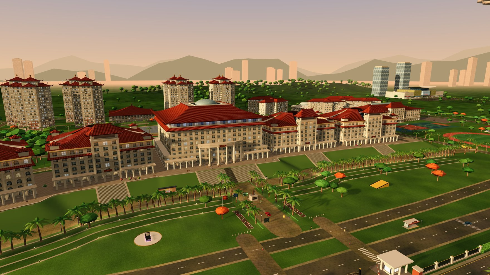
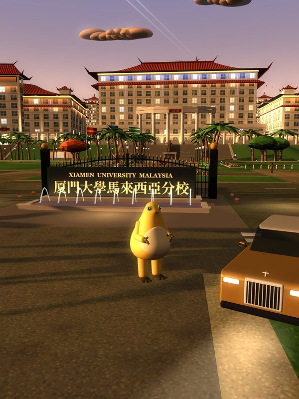
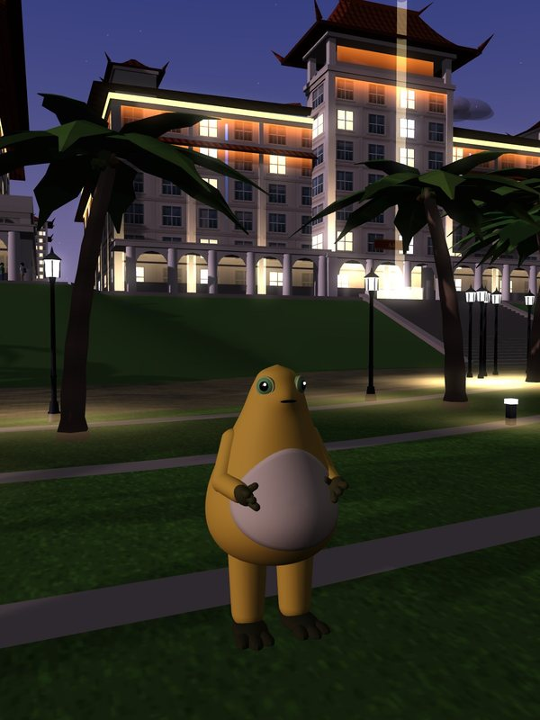
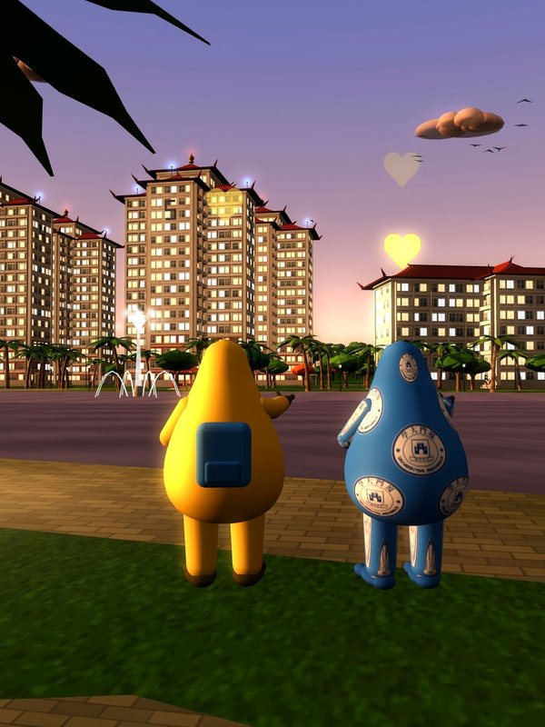
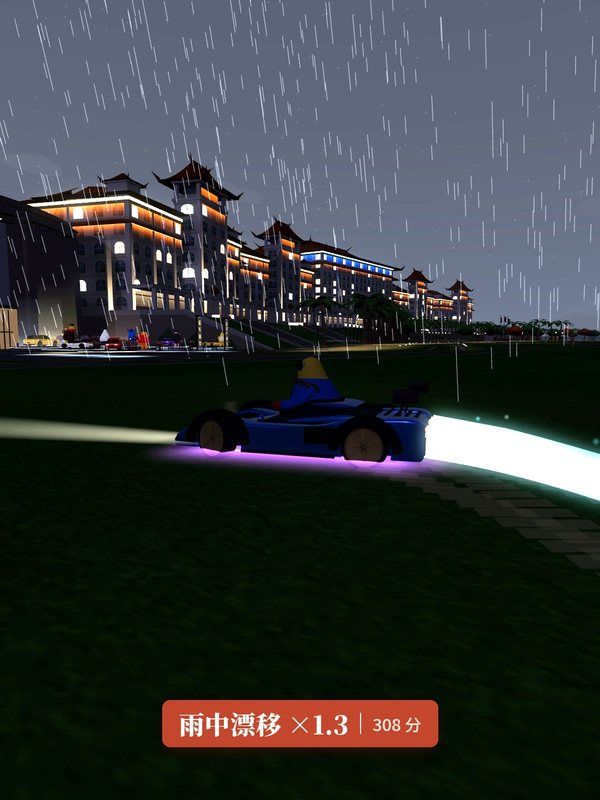
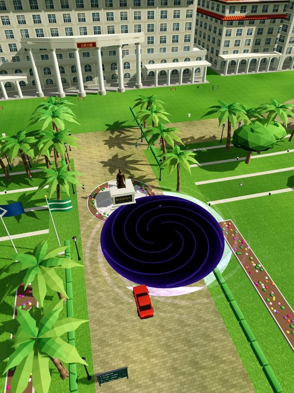
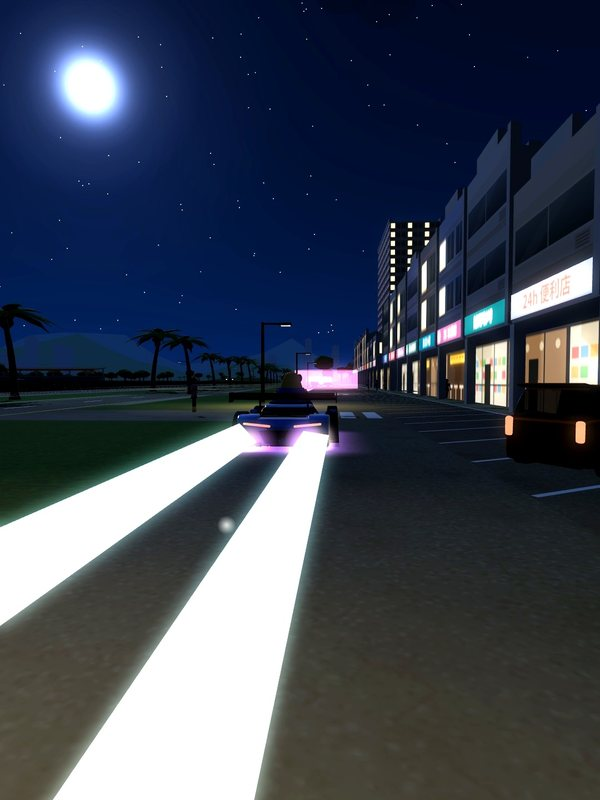
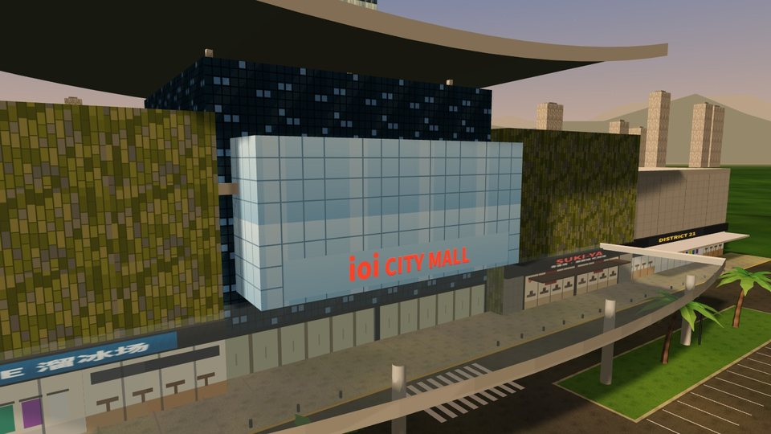
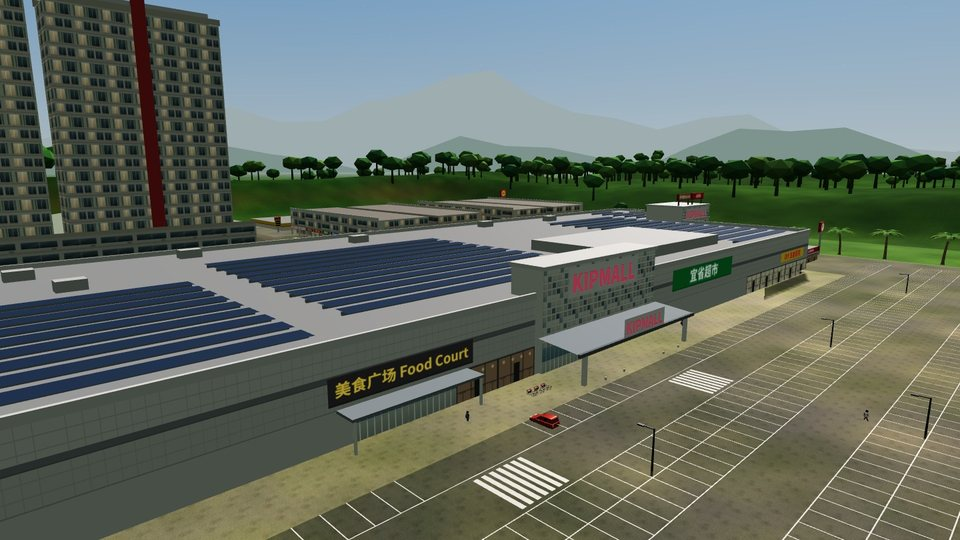

<h1 align="center">XMUM 校园漫游</h1>

<p align="center"><b>我把厦门大学马来西亚分校做成了一个 3D 开放世界游戏。</b><br>
打开网页就能玩，手机电脑都行，不用安装。还能看到同时在线的同学。</p>

<h3 align="center">👉 <a href="https://izhengjy.github.io/xmum-campus/">点这里开玩：izhengjy.github.io/xmum-campus</a></h3>

<p align="center"><a href="https://izhengjy.github.io/xmum-campus/"></a></p>

<table>
<tr>
<td align="center"><br><sub>校门口，远处是 A3</sub></td>
<td align="center"><br><sub>蓝调时刻的主楼</sub></td>
<td align="center"><br><sub>和学长看晚霞</sub></td>
</tr>
</table>

<p align="center"><br><sub>奶娃航空飞过宿舍楼</sub></p>

## 🎮 能玩什么

<table>
<tr>
<td align="center"><br><sub>雨夜漂移</sub></td>
<td align="center"><br><sub>黑洞吞掉校园</sub></td>
<td align="center"><br><sub>Bell 街夜赛</sub></td>
</tr>
</table>

<table>
<tr>
<td align="center"><br><sub>校外 · IOI City Mall</sub></td>
<td align="center"><br><sub>校外 · KIP Mall</sub></td>
</tr>
</table>

- 🗺️ **按实景还原的校园**：A 区台地、芙蓉湖、图书馆、音乐厅、宿舍、Bell 商业街、IOI City Mall……时间会走，有雷阵雨和烟霾。
- 📖 **大一主线**：8 章剧情加尾声，通关生成你的「我的大一」回顾卡。
- 🚗 **开车**：喷漆、改装（氮气、尾焰、轮毂、尾翼）、通缉星级、20 个隐藏特技跳台。
- 🏁 **竞速**：5 条赛道加卡丁车场，人机赛、道具赛、影线 1v1。
- 🎯 **小游戏**：外卖、麦当当得来速、SUKI-YA 抢火锅、KIP 超市大乱斗、B1 游戏厅……
- 📻 **车载电台**：三个原创电台，音乐在浏览器里现场合成，会按天气和车速自动选歌。
- 👥 **联机**：看到附近的同学，搭车、表情、当面挑战、加好友；全服排行榜、留言墙；用 Google 登录可以云存档。

<details>
<summary><b>⌨️ 操作</b></summary>

**电脑**：WASD 走路和开车 · Shift 跑 / 氮气 · 空格 跳 / 漂移 · F 上下车、互动 · E 水枪 · M 电台 · G 车行 · C 衣橱 · Z / V 表情和喊话 · P 暂停。拖动鼠标转视角。

**手机**：左下摇杆移动，右下按钮做动作，拖动屏幕转视角。**横屏玩视野更大**；iPhone 在 Safari 里「添加到主屏幕」后打开就是全屏。

</details>

## 更多

- 📊 [玩家实时数据](https://izhengjy.github.io/xmum-campus/stats.html)：在线人数、玩什么最多、用什么设备（不记录昵称、邮箱、位置）。
- 🐛 **反馈**：游戏里点「反馈」，或者直接[开一个 Issue](https://github.com/iZHENGjy/xmum-campus/issues/new/choose)。
- 🗂️ 更新记录看 [Releases](https://github.com/iZHENGjy/xmum-campus/releases)；旧版说明在 [docs/versions](docs/versions/)。

<details>
<summary><b>🛠️ 本地运行和参与开发</b></summary>

```bash
python -m http.server 8000
```

打开 http://localhost:8000/test/offline.html ：和正式页面一样，只是不连数据库，不会把测试成绩写进排行榜。

想改代码：先开 Issue 说你想做什么，等回复再动手。新功能 PR 开到 `dev`，线上 bug 修复开到 `main`；改到 `main` 的 PR 改了 JS 或 CSS，要把 `index.html` 里的 `?v=` 加一。不要提交密钥和来源不明的素材；店名、车名都用谐音化名。自己 fork 想开联机，看 [docs/FIREBASE.md](docs/FIREBASE.md)。

</details>

## 致谢与声明

- [three.js](https://threejs.org/)（MIT）
- 字体：标题用 Noto Serif SC（Google Fonts, OFL），正文用设备自带的中文字体
- 「奶娃」形象致敬原作者，游戏里的模型是用代码拼出来的低多边形二创，不是原作素材。本项目是非商业的粉丝作品，原作者如有异议请开 issue，我们会撤下。
- 奶娃的笑声剪自 B 站视频[《奶龙捧腹大笑原版》](https://www.bilibili.com/video/BV1auFZzaE4W/)（UP 主：坦克兵三哥小号）开头约 3 秒，仅作非商业二创使用，原作者如有异议请开 issue，我们会立即撤下。
- 车载电台的音乐是游戏在浏览器里现场合成的，不是别人的歌。
- 车行里的车名、校外的店名（麦当当、星爸爸咖啡……）都是谐音化名，与任何真实品牌无关。
- 校名、楼名仅用于还原校园，本项目与厦门大学马来西亚分校无官方关系。建筑外观根据公开照片和学校的 360° 全景简化，楼层数是估计。
