# XMUM 校园漫游

照着厦门大学马来西亚分校（XMUM）2025 年 9 月的校园平面图，用 Three.js 搭的一个 3D 校园小游戏。打开网页就能玩，不用安装，手机电脑都行，还能看到同时在线的同学、上全校排行榜。

现在是 **v2.0**：校园按实景重做了一大片，多了竞速、改装车间、车载电台、豪车展台、留言墙、和别的玩家当面互动，手机能横屏全屏玩，人多的时候也不卡。

### 👉 [点这里在线开玩：izhengjy.github.io/xmum-campus](https://izhengjy.github.io/xmum-campus/)

> 粉丝作品，不是学校官方项目。建筑外观根据公开照片和学校的 360° 全景简化，楼层数是估计。

[](https://izhengjy.github.io/xmum-campus/)

## 游戏截图

| | |
|---|---|
|  | 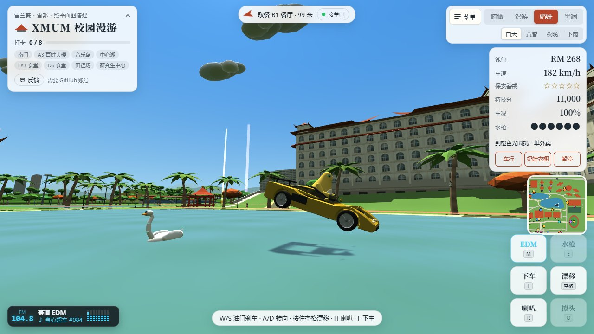 |
| **五星警戒**：黄昏的大路上，巡逻车已经贴到车尾，前面还在设路障。电台正放着「赛道 EDM」 | **飞进湖里**：182 km/h 冲上湖边跳台，飞过芙蓉湖，湖上的天鹅吓了一跳 |
|  | 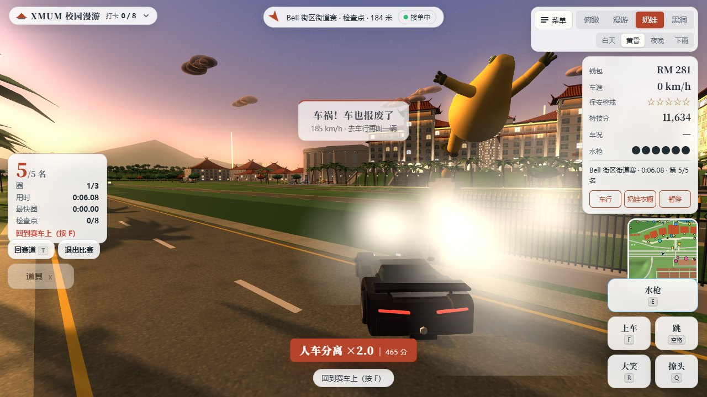 |
| **黑洞 2.0**：长到 28 米，一口吞掉国际学术交流中心（会议改期）。刚吞完，「DDL」就反超了 | **竞速**：Bell 街区街道赛垫底，185 km/h 撞上栏杆，车报废，奶娃飞了出去 |
| 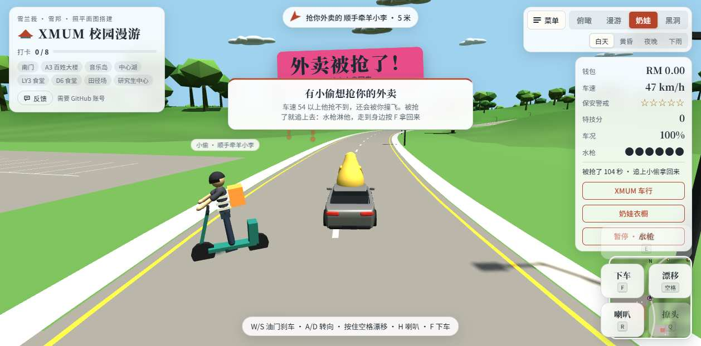 | 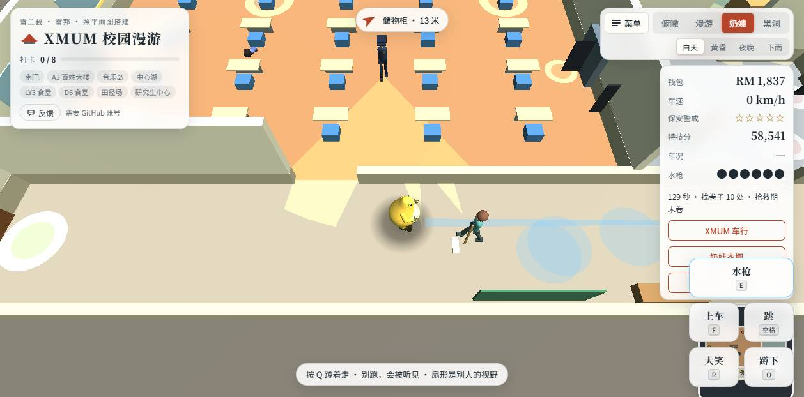 |
| **外卖被抢了**：送单路上车速不够快，「顺手牵羊小李」踩着滑板车把外卖抢走了，追上去拿回来 | **教学楼潜入**：戴小红帽的保安在教室里巡逻，奶娃蹲着从走廊溜过去找期末卷 |
| 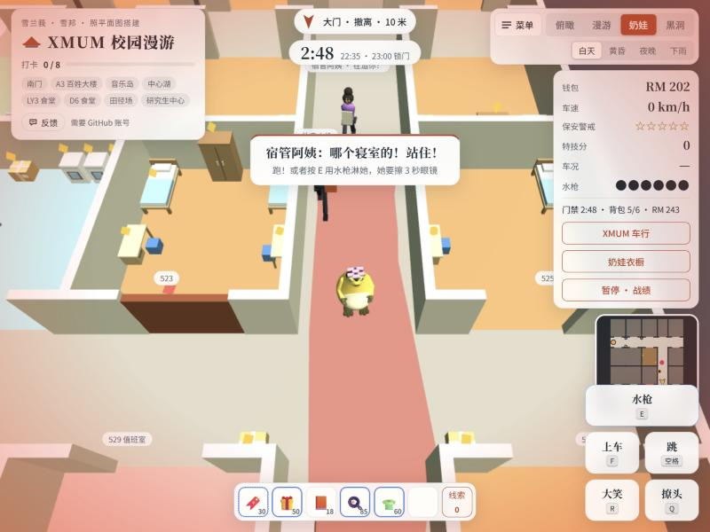 | 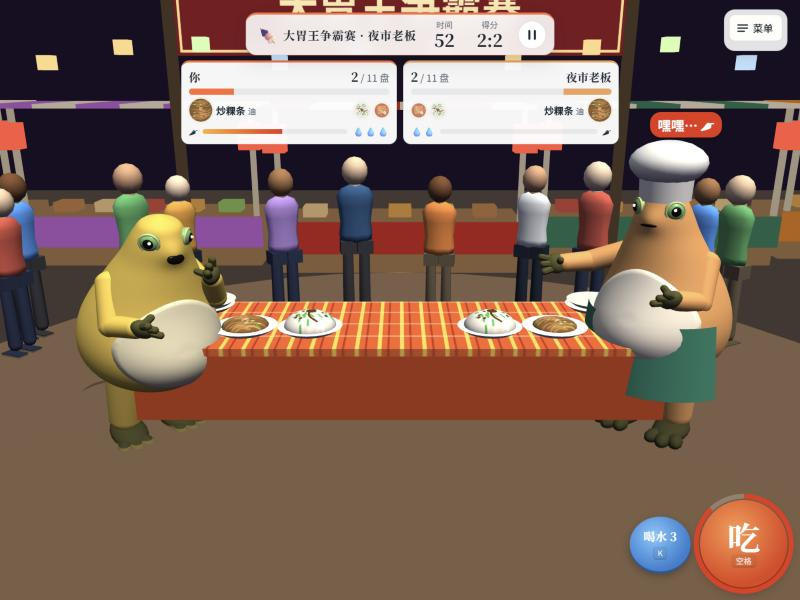 |
| **宿舍搜刮**：门禁前 2 分 48 秒，背包装了 5 件，宿管阿姨在走廊那头喊「哪个寝室的！站住！」 | **大胃王争霸赛**：和夜市老板比吃炒粿条，他头上冒辣椒，马上要往你盘里撒 |
| 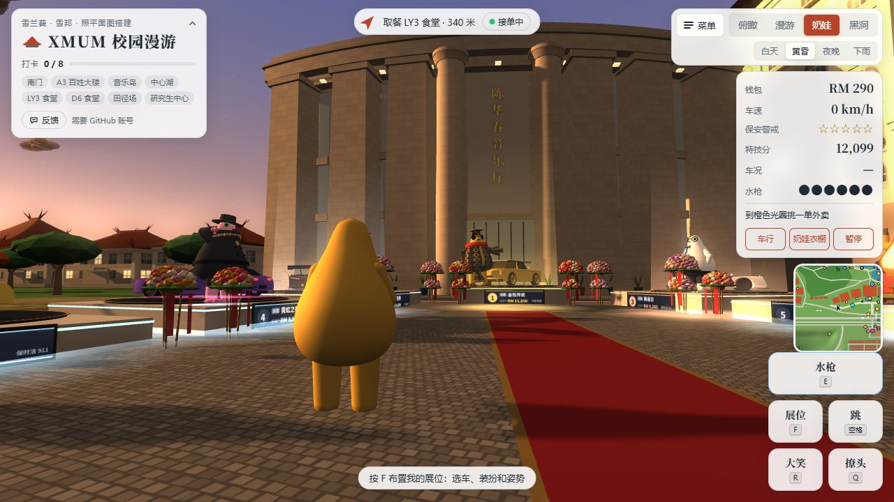 |  |
| **豪车展台**：钱包只有 RM 290 的奶娃站在陈华春音乐厅门前的红毯上，看着总资产第一的「金色传说」 | **午后阵雨**：大家都在找地方躲雨，只有奶娃站在芙蓉桥上哈哈大笑 |
|  | 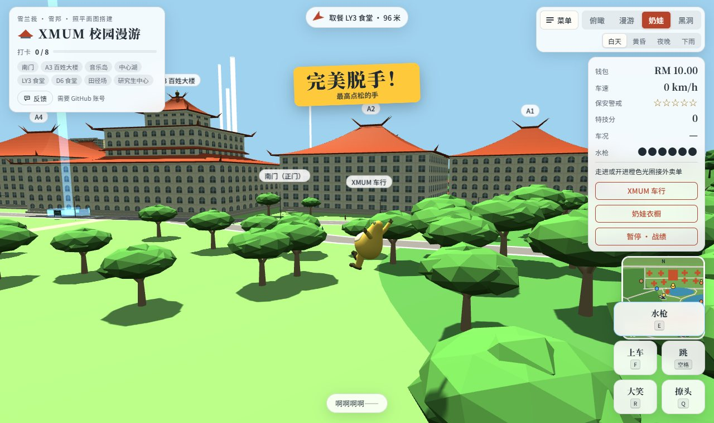 |
| **开工**：A3 百姓大楼大台阶上两个光圈在等人接活：「抢救期末卷」和「赶 DDL 交作业」。左边是留言墙 | **秋千**：荡到最高点松手，「完美脱手！」 |

## v2.0 更新了什么

### 校园还原
- **A 区台地**：A1–A5 坐在 6.5 米高的台地上，楼前是花岗岩大台阶和草坡，楼后缓坡一直落到湖边。
- **大门前院**：铁艺大门、门卫亭，校碑挪到大门外的小广场，碑前有喷泉。进门沿中轴线能一路走到陈嘉庚像和大台阶。
- **芙蓉湖**：芙蓉桥改成拱桥，人和车都能过；新修一圈环湖路；湖边亭和桥头亭两座六角亭；湖上有天鹅。
- **后山**：音乐岛西边的山，山顶有两层檐的观景亭，南边石阶步道上山，东边沿山脊的土路通到猴山。
- **图书馆**：A3 百姓大楼改成方楼加圆形玻璃采光顶；A1、A2、A4、A5 换成「风车顶」。
- **陈华春音乐厅**：A1 西边，弧形大立面加六根方柱，门前是新的石砖广场。
- **夜景**：教学楼底层拱廊、连廊、路灯和窗户晚上都会亮。
- **各处细节**：东门、田径场、球场、停车场、B1 大门、宿舍阳台、校门南区的黑栅栏；校外麦当当停车场、Bell 店屋的屋顶和夜景；人物坐姿、车顶胶条、室内地板……

### 新玩法
- **竞速**：地图上 5 面格子旗，5 条赛道，可以跑人机赛、道具赛或影线 1v1。
- **改装车间（第二轮）**：改装要按真实时间施工，从几分钟到将近一天；新增氮气、弹射起步、漂移增压、尾焰；新车型铁方越野和疾风 R 运动摩托；几乎所有玩法都会掉改装零件。
- **车载电台**：三个原创电台，音乐全部在浏览器里现场合成（没有音频文件）；可以单曲循环、收藏到这辆车，也可以花钱外放给附近的人听。
- **豪车展台**：陈华春音乐厅门前 7 个展位，站着全服总资产前七的奶娃和他们的爱车。
- **大胃王争霸赛**：Bell 夜市的新小游戏，三位对手一个比一个能吃。
- **KIP 超市大乱斗**：取代原来的「KIP 购物车冲刺」，推着购物车和 AI 顾客抢货。
- **教学楼潜入**：「抢救期末卷」重做成多房间潜入，还有三种轮换委托。
- **B1 游戏厅第二轮**：奶娃投篮重做（能跑位、有人防守、能斗牛），食堂端盘子加到五个模式。
- **玩家当面互动**：表情、预设短句、搭别人的车、当面挑战（联机时才有）。
- **图书馆门口的留言墙**：贴便利贴、点赞。
- **宿舍蹲着走**：Q 蹲下，蹲着没声音，停在家具旁边就是躲起来；宿舍撤离也上排行榜。
- **其他**：接外卖和任务先看卡片再决定接不接；被追时冲进喷漆车间自动关门换漆；水枪改成鼠标指哪喷哪；猴子会躲水、躲石头、上树。

### 手机体验
- **横屏**：HUD、开场画面、各个面板都为横屏重新排过版。
- **全屏和添加到主屏幕**：开场画面和游戏里都有「全屏」；iPhone 上「添加到主屏幕」以后从主屏幕打开就没有地址栏。
- **天气按钮**：游戏顶部一个圆按钮，换白天、黄昏、夜晚和下雨。
- **弹窗变小**：提示收成顶上的小通知条，接单卡片收成胶囊，不挡路。
- **不会误触放大**：双击、双指不会再把整个页面放大。
- **声音**：iPhone 侧边静音键开着也有声音，来电或切 App 回来会自动恢复。

### 性能和联机
- **画质档位**：流畅 / 标准 / 高清，开场画面可选；卡的时候自动降分辨率（三档动态分辨率）。
- **远程玩家分级显示**：25 米内完整模型，150 米内简化模型，更远只显示名字。
- **联机流量大幅下降**：只收附近的人，位置用推算补帧，按大家在地图上的分布，流量降到原来的 1/8 到 1/58。
- **在线人数上限和满员排队**：满员时先单机玩，每隔 30–60 秒自动看一次，有空位就自动连上。
- **其他**：后台放着或停在开场画面不动会自动断开，回来自动连上；中文字体改用设备自带的，首次打开少下载约三分之二的字体文件。

> 想看 v1.0 时的样子：[v1.0 README 存档](docs/versions/v1.0/README.md)（连同当时的截图）。

## 四种玩法

### 奶娃（开放世界）

奶娃在校园里走路、抢车、开车：

- **赚钱**：送外卖。走进橙色光圈会弹出接单卡片，取餐点一次有两三单可挑（近单、远单或跨区单、加急单），按 F 或 1 2 3 接，X 跳过，不想被打扰按 J 关掉接单。每天有一单「今日加急」，报酬更高。
- **追捕**：撞人、撞车会被保安追，警戒最多五星，躲一阵子就会消。
- **特技**：漂移、飞跃、惊险擦车都能攒特技分，连起来有连击倍数。
- **挑战**：走进发光的圈就能开始，按用时或分数拿金、银、铜牌。
  - 环湖赛
  - 早八冲刺：07:59 从宿舍出发，08:00 前冲到 A3
  - 田径场漂移
  - 飞跃挑战
- **竞速**：地图上有 5 面格子旗，开着自己的车慢慢开进圈，选一种比法：
  - **人机赛**：和电脑对手比名次。
  - **道具赛**：赛道上捡道具，按 X 用。
  - **影线 1v1**：和自己或排行榜上别人跑过的影线比，也可以单人计时。
  - 5 条赛道：校园环线、Bell 街区街道赛（3 圈窄巷）、山梁拉力、山野越野（走土路翻山）、油棕园公路冲刺。
  - 跑偏了按 T 回赛道。比赛中警戒清零、不接外卖单；撞到车报废才会被甩出去。
- **教学楼潜入**：A3 门口两个光圈接活。红圈永远是「抢救期末卷」，蓝圈是轮换的委托：赶 DDL 交作业、拿回被没收的手机、夜闯自习楼。
  - 教学楼一层有走廊、教室、打印室、教师办公室。按住 F 翻找，Q 蹲着走没声音，蹲在课桌、沙发、箱子旁边不动就是躲起来。
  - 楼里有五种人：戴小红帽的保安（地上的扇形是视野）、批卷时会抬头看的老师、拖地的清洁阿姨（湿地上跑会滑倒）、趴着睡觉的学霸（吵醒了会喊人），还有打印室里花 RM 15 就帮你缠住保安的同学。
  - 被保安抓住会被请出楼、扣 10 秒、东西被收走。按剩余时间拿金、银、铜牌，全程没被发现有奖金。
- **能进去的教学楼**：A1、A2、A4、A5 门口有黄色的圈，走过去按 F 进去。镜头从上往下看。躲在楼里，巡逻车只能在楼门口等。
- **B1 游戏厅**：学生活动中心南门有粉色的圈，走过去按 F 进去；开场画面点「小游戏」也能直接进。
  - 里面是一排街机，走到机台前按 F 开玩，也可以在「游戏列表」里直接选。现在有四个小游戏：
    - **食堂端盘子**：D6 午高峰，端着盘子穿过横着走的同学送到餐桌，撞到就洒。五个模式：经典、叠盘挑战、午高峰、指定桌号、无尽。
    - **奶娃投篮**：在半场里自己跑位，按住蓄力、力量条到绿色松手；离得越远越难，线外 3 分；蓝色奶娃一直贴身防守，还能和他斗牛。
    - **KIP 超市大乱斗**：推着购物车和 AI 顾客抢清单上的货、互相撞，推到收银台扫码。
    - **大胃王争霸赛**：见下面的 Bell 夜市。
  - 得分换 RM，拿金、银、铜牌，每个小游戏有自己的排行榜。
  - 想加新的小游戏，看 [docs/MINIGAMES.md](docs/MINIGAMES.md)。
- **水枪**：步行时按 E 或点鼠标左键，鼠标指哪喷哪，没有自动瞄准；地上的蓝线是水柱能到的地方。手机点「水枪」朝面前喷，按住拖动可以瞄准。
  - 淋到巡逻车，车会停下来擦玻璃 4 秒；淋到保安，他会擦脸。
  - 一箱 6 发，用完会自己慢慢回满。
- **宿舍搜刮**：7 栋 LY 宿舍门口有紫色的圈，步行按 F 进去。每次进去楼层都重新生成。
  - 22:30 进门，23:00 宿管锁门（现实 3 分半）。按住 F 搜柜子、抽屉、床底、快递箱，背包只有 6 格，要取舍。
  - 东西要带到撤离点才算你的：大门（绿圈）、消防梯（橙圈，会响警报）、后门（蓝圈，要密码）。带出来的自动卖成 RM。
  - 被宿管阿姨抓到或超时，背包里的东西全部没收。地上的光扇是她的视野；跑步她听得见。
  - **蹲着走**：按 Q（手机「蹲下」）蹲着走没声音、宿管看不远，停在床、衣柜、书桌、快递箱旁边就是躲起来。
  - 上锁的后门、储物柜、寝室要解谜：线索在便利贴、白板课程表、手机上，每局都不一样。
  - 偷外卖的小偷会偷你背包里最贵的东西再往消防梯跑。用水枪淋倒他，按 F 抓住，拿回东西还有悬赏。
  - 限量周边另外给「周边券」，在衣橱里换 6 件宿舍独家配件（卷发筒、搪瓷脸盆、外卖保温箱……）。
  - 一局带出来的最高收入会上「小游戏」排行榜。
  - 车行里有**水枪工坊**：花 RM 升级喷嘴（射程）、水压（淋湿和定身的时间，水柱也飞得更快）、水箱、回水泵，还有高压水炮（一次喷三股，2 级能把目标冲退）。
- **对手强度**：水枪升级越多、成就越多，对手越难缠（普通 → 警觉 → 难缠 → 凶猛）。不升级也能玩。
  - 巡逻车三星以上会包抄：一辆跟在后面，其余的抢到前面和两侧去截你；强度上去后四星就设路障。
  - 保安被淋了会喊同伴，第二个保安从门口进来一起追。
  - 猴子会成群反击，强度高了还有淋一枪赶不走的猴王。
- **秋千**：音乐岛西边、树林边的草坪上。按 F 坐上去，按住空格（手机按住「荡」）越荡越高，荡到前面最高点松手就飞出去，算一次特技，飞得越远分越高。前面的草地上画了 10、20、30、40 米的刻度线。
- **猴山**：树林西北角的小山，从东边的路沿土路上山顶，也可以从后山沿山脊走过去。猴子就住在山顶空地周围，步行或慢车靠近会被抢：正在送外卖就抢外卖，否则掏走一点钱。
  - 用水枪淋它，或者凑近了大笑（R），东西就抢回来了。猴子会侧跳躲水、躲在石头后面扔果子、爬到树上往下扔，还会把外卖传给同伴。
  - 在树林别处偶尔也会有一两只从树上跳下来捣乱。
  - **猴子大战**：山顶空地东口的棕色光圈，下车走进去开始。限时把一群猴子全赶跑，抢回 3 袋外卖，按剩余时间拿金、银、铜牌。
- **顺风车**：载上赶课、晕车、拍视频的同学，开得好拿五星好评。
- **麦当当得来速**：开车进得来速车道，在点餐牌前停稳选一份（普通单、会化的麦旋风、怕颠的派对桶），绕到取餐窗口停准拿餐，再限时翻过山梁送回学校。撞车和落地太猛会把餐洒掉。夜晚全是报酬更高的「夜宵加急」。
- **偷外卖的小偷**：送单途中会有小偷冲上来抢你的外卖。车速 54 以上他抢不到，对着他撞过去还能把他撞飞；慢下来或下了车就会被抢。被抢后倒计时照走：追上去，水枪淋他、开车撞倒他，走到身边按 F 拿回来接着送。没追回来这单没钱，还掉一颗「店铺信用」（影响每单报酬）。取餐点门口也有人偷别人的外卖，抓到有悬赏；Bell 路口的通缉榜上有六个人，抓完一轮下一轮更快、更会钻小巷。
- **KIP 超市大乱斗**：KIP 商场门口的粉色光圈按 F 进门，和两三个 AI 顾客在超市里抢清单上的货，可以开过去撞他们，最后推到收银台一件件扫码，四个场次越来越难。B1 游戏厅里也有这台。商场停车场的购物车平时也能开着玩。
- **蜜雪冰橙打工**：走到 Bell Avenue 的蜜雪冰橙门口，照订单按顺序加料，再卡准时机摇，45 秒做得越多越好。手机上是四个大按钮。
- **Bell 夜市**：夜晚 Bell Avenue 后巷会摆出一排摊位，把五种小吃吃一遍有奖励。
  - **大胃王争霸赛**：夜市中间的红圈「开吃」。和对手站在长桌两头吃同一份菜单（沙爹、椰浆饭、炒粿条、叻沙、榴莲……），谁先吃完谁赢。狂点「吃」，点太快会噎住；越吃越辣，一局只有 3 杯水。三位对手：邻座学长、撒辣椒的夜市老板、会拍桌子吓你的「无底洞」肚神，赢了上一位才能挑战下一位。
- **跨区外卖**：校外有星爸爸咖啡、KIP 美食广场两个取餐点；出入校门的单按路程加报酬。
- **XMUM 车行**：用攒的钱买车。车名全是谐音恶搞，比如兰博鸡尼、玛莎拉弟 GT，还有方盒子硬派的铁方越野和一撞就飞的疾风 R 运动摩托。
- **改装车间**：在车行里。轮毂、宽体、尾翼、霓虹、排气、姿态、越野件、摩托件。点零件能在 3D 里先看改完的样子。
  - **买车不用等，改装要等**：下单扣金币和改装道具，按真实时间施工，轻改几分钟，顶级改装要将近一天（明天再来提）。关掉游戏也照样算时间，施工中的车照样能开，完工回车行「提车」。
  - **改装道具**：送外卖、抓小偷、猴子大战、宿舍撤离、小游戏奖牌、成就都会掉。
  - **开起来的效果**：氮气（按住 Shift 或 N）、弹射起步、漂移增压，还有光轨、火焰、等离子三种尾焰。别的玩家能看到你车上的外观改装。
- **车载电台**：上车自动开，按 M 换台：霓虹夜驾 → 芙蓉湖 Lo-fi → 赛道 EDM → 关（手机点「电台」）。点电台小条打开面板：
  - 单曲循环、收藏到这辆车；
  - 外放：每分钟 RM 0.5，40 米内的玩家都听得到；搭你车的人也会听到同一首。
- **豪车展台**：陈华春音乐厅门前的红毯两边 7 个展位，站着全服总资产前七的奶娃和他们的爱车，名牌上写着总资产。走到展台前按 F 布置自己的展位：选车、装扮和姿势。白天晚上都放烟花。
- **留言墙**：A3 百姓大楼（图书馆）门前台阶西边的软木墙。走近按 F 打开：
  - 贴一张便利贴，最多 40 字、6 种颜色；每人同时只有一张，10 分钟能贴一次。
  - 可以点赞、隐藏、举报；赞最多的贴在墙正中间。
  - 发之前会过滤脏话、广告、链接和联系方式。
- **玩家当面互动**（联机时才有）：
  - 走到别的玩家身边（4 米内）他头上出现「F 互动」，可以搭车、打招呼、当面挑战（飙车抢点、特技比拼、抓人），也能屏蔽这个人。
  - 表情 8 个（Z），喊话 20 句预设短句（V），不能自由打字。70 米内的人看得到。
  - 搭车：别人接受后你就坐上他的车跟着走。
  - 不想被打扰可以开「免打扰」，邀请自动拒绝。
- **奶娃衣橱**：用 RM 买皮肤（橙、粉、白、蓝、虹彩、星空、XMUM 校徽、鎏金）、身形（圆滚滚、瘦高、大只）、服饰（警察制服、圣诞衣装、侦探风衣、蓝衣英雄、帝王袍……）和配件（西瓜头盔、菠萝头盔、珍珠耳环头巾、墨镜、红披风、珍珠奶茶……）。点一件就能试穿，镜头转到奶娃正面。
- **喷漆店**：在车行里，给自己的车换普通漆、金属漆、哑光、镀铬，再贴火焰、赛车条纹、西瓜纹、奶娃贴纸等贴花。Bell Avenue 西头还有一间喷漆车间：被保安通缉时，开着自己的车直接冲进去，卷帘门马上落下，自动换一种漆，开门时警戒清零（每星 RM 50）。
- **成就**：暂停面板里能看进度，新玩法都有自己的成就。

### 黑洞 2.0

控制地上的黑洞，从小东西开始吞，越吞越大，最后能吞整栋楼：

- **对手**：和三个 AI 黑洞「DDL」「早八」「期末周」抢地盘，150 秒结算。
- **互吞**：比你大的黑洞会吞掉你。
- **道具**：地上有发光道具，分别是加速、磁铁、双倍、冰冻。
- **连吞**：连续吞东西有连击加成。
- **难度**：开局可以选轻松、普通、困难。

### 漫游

第一人称在校园里走，找 8 个金色打卡点。

### 俯瞰

转着看整个校园，点楼看介绍，可以「走到这里」。

### 校园环境

- 白天、黄昏、夜晚可以切换。
- 午后会下阵雨，有雨丝、积水和雨声，也可以点「下雨」按钮手动开关。
- 天上有飞鸟和奶娃航班，草地上有校园小猫，芙蓉湖上有天鹅。
- 画质有流畅、标准、高清三档，在开场画面选。没选过时，手机默认标准，电脑会按显卡自己挑。

## 操作

**电脑**

| 按键 | 作用 |
|---|---|
| WASD | 走路、开车、移动黑洞 |
| Shift | 跑；开车时按住放氮气（装了氮气才有，也可以按 N） |
| 空格 | 跳；开车时按住漂移 |
| F / Enter | 上车、下车（开太快下车会被甩飞）；进门、翻找、打开展位和留言墙；接单 |
| R / Q / H | 大笑、撩头、按喇叭 |
| Q | 在教学楼潜入、宿舍里是蹲下 / 起身 |
| E / 鼠标左键 | 水枪（步行时），鼠标指哪喷哪 |
| M | 车载电台换台 |
| G | 打开 XMUM 车行（里面有喷漆店、改装车间和水枪工坊） |
| C | 打开奶娃衣橱 |
| 1 2 3 / X / J | 接单卡片：选一单 / 跳过 / 开关「接单中」 |
| T / X | 竞速时：回赛道 / 用道具 |
| Z / V | 表情轮盘 / 喊话（联机时）；收到邀请时 F 接、X 不接 |
| P / Esc | 暂停，看战绩和成就 |

拖动鼠标转视角。

**手机**

- 左下摇杆移动，推到底是跑；右下按钮做动作（上车、跳 / 漂移、大笑、撩头；教学楼和宿舍里是蹲下 / 起身）。
- 「水枪」点一下朝面前喷，按住拖动可以瞄准；开车时有「电台」「氮气」按钮；联机时有「表情 · 喊话」。
- 拖动屏幕转视角，俯瞰时双指缩放。
- **横屏玩视野更大**。开场画面的「全屏」可以藏起浏览器地址栏；iPhone 要先在 Safari 里「添加到主屏幕」，再从主屏幕打开。
- 游戏顶部的圆按钮（☀️ / 🌇 / 🌙）换时间和天气。

## 联机、排行榜和存档

线上版已经开了联机，数据存在 Firebase，服务器在新加坡。

- **在线玩家**：打开网页自动匿名登录，不用注册。在奶娃或漫游模式里能看到附近同学的奶娃（连同穿戴）、开的车（连同喷漆和外观改装）和头顶的名字。
  - 只显示附近的人：25 米内是完整模型，150 米内是简化模型，再远只显示名字。
  - 网页切到后台超过 60 秒，或者停在开场画面 1 分钟不动，会自动断开，回来自动连上。
- **在线人数上限**：同时在线的人数有上限，开场画面显示「在线 N/上限」。满员时你先单机玩（不显示别人，自己的进度照常），每隔 30–60 秒自动看一次，有空位就自动连上。排队时排行榜、昵称和云存档照常能用。
- **排行榜**：开场画面点「排行榜」，四个榜加上小游戏榜。

  | 榜 | 比什么 |
  |---|---|
  | 黑洞 2.0 | 吞掉校园的百分比 |
  | 黑洞 1.0 | 旧版黑洞的成绩，已停止更新，留作纪念 |
  | 特技 | 特技分 |
  | 总资产 | 钱包加上车和改装的价值 |
  | 小游戏 | B1 游戏厅里每个小游戏、每个模式一张榜，还有宿舍撤离的单局最高收入 |

  竞速另外记每条赛道的最快影线，别人可以选你的影线来比。
- **Google 登录和云存档**：开场画面可以「用 Google 登录」。登录后：
  - 钱、车、改装、成就、最好成绩会存到云端，换手机或电脑登录同一个账号就能接着玩。
  - 昵称也跟着账号走。
  - 不登录也能玩，进度只存在当前浏览器里。

想在自己 fork 的版本里开联机，按 [docs/FIREBASE.md](docs/FIREBASE.md) 配一个自己的 Firebase 项目。

## 玩家数据

### 👉 [打开实时数据页面](https://izhengjy.github.io/xmum-campus/stats.html)

实时页面每次打开都直接读数据库，是最新的数字。

下面几张图是定时生成的快照：GitHub Actions 设成每 15 分钟更新一次，但 GitHub 的定时任务经常推迟甚至跳过，图可能落后几个小时。想看准确的数字，请打开上面的实时页面。


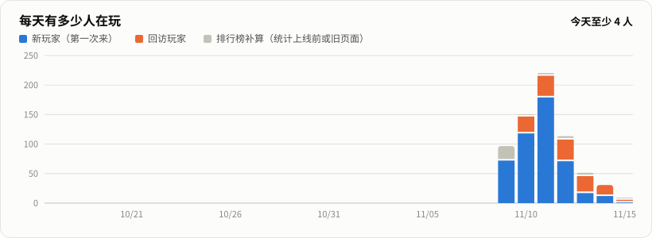

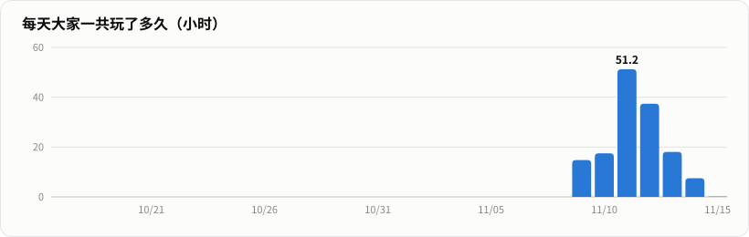

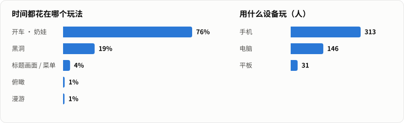

想看具体数字，可以打开 [数据表格](https://github.com/iZHENGjy/xmum-campus/blob/stats/README.md)。

**怎么算的**
- **一个玩家**：一个浏览器里的匿名身份。同一个人换了手机和电脑，会算两个人；用 Google 登录以后，在哪台设备上玩都算同一个人。
- **游戏时长**：只算网页开在前台、而且 3 分钟内有过操作的时间。挂着不动不算。
- **只统计线上网站**：本地打开或者别人 fork 的版本都不计入。
- **统计上线前的玩家**：游戏时长从 2026-11-09 晚上开始记录，之前没有。为了不漏人，玩家数还会去查排行榜：在某一天上过排行榜、但那天没有时长记录的人，会算进「排行榜补算」。这些人可能是统计上线前玩的，也可能还开着没有统计功能的旧网页。
  - 补算只能算到上过排行榜的人，所以每天的数字是「至少」这么多。
  - 「累计游戏时长」和「人均游戏时长」只按有时长记录的人算。

**记录了什么**
- 匿名 ID（和排行榜用的是同一个）
- 第一次和最近一次玩的日期
- 每天玩了几秒、每个玩法玩了几秒
- 设备是手机、平板还是电脑

不记录昵称、邮箱、位置、IP，也不记录成绩。

## 反馈

发现 bug 或者有想加的玩法，点开场画面或游戏里的「反馈」按钮，选「报告 bug」或「提建议」，会在新标签页打开本仓库的 [新建 Issue](https://github.com/iZHENGjy/xmum-campus/issues/new/choose) 页面。

- **需要 GitHub 账号**：没登录的话，GitHub 会先让你登录或注册。
- **自动填好的信息**：游戏版本号、当前模式、设备和浏览器、屏幕尺寸。
- **不会带上的信息**：昵称、邮箱、账号。

## 如何参与

欢迎提 Issue 和 PR。为了不让大家白忙，请按下面的顺序来。

**没有 GitHub 账号？**
- 注册一个是免费的，用邮箱几分钟就好，注册后就能点游戏里的「反馈」。
- 不想注册的话，可以请有账号的同学帮你提，或者直接把问题和截图发给作者。
- 说清楚三件事就够了：在哪个模式、怎么操作出现的、看到了什么。

**想改代码、提 PR？**
1. **先开 Issue，说明你想做什么。** 可以选「提建议」，写清楚要改哪里、为什么。等作者回复同意再动手，免得花了很多时间，做出来的却是这个项目不打算要的功能。修小 bug（错别字、明显的显示问题）可以直接提 PR。
2. **从你 fork 的仓库开新分支，一个 PR 只做一件事。** PR 描述里写上对应的 Issue 编号（比如 `Closes #12`），以及你在什么设备、什么浏览器上测过。
3. **选对目标分支。** 新功能开到 `dev`（下一个版本），线上 bug 修复开到 `main`。
4. **`?v=` 版本号**：改到 `main` 的 PR，改了 JS 或 CSS 要把 `index.html` 里所有的 `?v=` 加一，不然同学的浏览器会继续用旧缓存；开到 `dev` 的不用改，发布时统一改。
5. **本地测试别把测试成绩刷到正式排行榜。** 用离线测试页 `test/offline.html`（见下面「本地运行」），或者把 `js/firebase-config.js` 里的 `window.XMUM_FIREBASE` 临时改成 `null`（单机模式），这个改动不要提交。
6. **改了 `database.rules.json`**，在 PR 里写明「需要重新发布规则」。
7. **不要提交密钥、个人信息，或者来源不明的图片和音频素材。** 游戏里的店名、车名都用谐音化名，不要出现真实品牌名和 logo。

`main` 分支只接受 PR，由作者测过再合并。

## 本地运行

需要一个静态文件服务器。直接双击 `index.html` 打不开，因为浏览器会拦截本地脚本。

```bash
python -m http.server 8000
```

然后打开 http://localhost:8000 。

本地测试建议打开 http://localhost:8000/test/offline.html ：和正式页面一样，只是不连数据库（不登录、不写排行榜和云存档）。

## 代码结构

没有构建步骤，`index.html` 按顺序加载 `js/` 里的普通脚本，它们共享同一个全局作用域。每个脚本地址后面的 `?v=` 是缓存版本号。

| 文件 | 内容 |
|---|---|
| `js/quality.js` | 画质档位（流畅 / 标准 / 高清），最先加载 |
| `js/00-core.js` | 渲染器、相机、材质、建筑生成器 |
| `js/09-azone.js` | A 区台地：大台阶、草坡、挡土墙、后坡 |
| `js/10-world.js` | 地面、道路、湖、芙蓉桥、所有楼、植物、天空、昼夜 |
| `js/12-terrain.js` | 山地地形、后山、地图边界、校外道路 |
| `js/13-outskirts.js` | 校外：Bell Avenue、去 KIP 的山路、麦当当、街上的行人 |
| `js/15-props.js` | 斑马线、路灯、巴士站、指示牌、旗杆、单车架等校园小品 |
| `js/16-ambient.js` | 午后阵雨（雨丝、积水、雨声）、飞鸟、校园小猫、手机上的天气按钮 |
| `js/18-gfx.js` | 夜晚灯光、水面、树叶摆动、泛光、远近模型切换 |
| `js/20-fx.js` | 粒子、刹车痕、合成音效 |
| `js/30-naiwa.js` | 奶娃模型和动画，身形参数和换装挂点 |
| `js/32-wardrobe.js` | 奶娃衣橱目录（皮肤、身形、服饰、配件）和穿戴，车漆和贴花 |
| `js/40-vehicles.js` | 跳台、车辆模型与物理、上下车、步行 |
| `js/42-gate.js` | 大门、门卫亭、校碑小广场 |
| `js/42-tuning.js` | 改装道具、配方、零件目录，把零件装到车上 |
| `js/44-hill.js` | 后山：观景亭、石阶步道、山脊土路 |
| `js/45-auditorium.js` | 陈华春音乐厅和门前广场 |
| `js/50-missions.js` | 外卖任务、指南针、打卡 |
| `js/60-details.js` | 长椅、停车场、喷泉、学生 |
| `js/70-hole.js` | 黑洞 2.0：AI 黑洞、道具、连吞、难度 |
| `js/80-gta.js` | 保安追捕、特技连击、撞车判定、车行、水枪工坊、对手强度、成就 |
| `js/85-activities.js` | 环湖赛、早八冲刺、田径场漂移、飞跃挑战、顺风车、擦车与慢动作、暂停面板 |
| `js/86-guard.js` | 「小红帽」保安造型 |
| `js/87-classroom.js` | 能进去的教学楼、水枪（`wgAddTarget` 注册水枪目标） |
| `js/87-heist.js` | 教学楼潜入：抢救期末卷和三种委托、蹲下 |
| `js/88-wardrobe-ui.js` | 奶娃衣橱、喷漆店和喷漆车间的界面、试穿镜头、存档、成就 |
| `js/89-dorm.js` | 宿舍搜刮：楼层生成、宿管和小偷、搜刮、谜题、撤离 |
| `js/89-dorm-ui.js` | 宿舍搜刮的界面（背包、密码键盘、线索本、结算）和衣橱独家配件 |
| `js/89-offers.js` | 接单卡片（`offerJob`） |
| `js/89-outskirts-play.js` | 校外玩法：得来速、蜜雪冰橙打工、Bell 夜市、抓小偷和通缉榜、跨区外卖 |
| `js/89-swing-monkeys.js` | 秋千、猴山的猴子、猴子大战 |
| `js/90-main.js` | 模式切换、输入、镜头、小地图、主循环 |
| `js/91-arcade.js` | B1 游戏厅和小游戏平台（`XMini`） |
| `js/minigames/` | 小游戏：食堂端盘子、奶娃投篮、KIP 超市大乱斗、大胃王争霸赛 |
| `js/92-racing.js` | 竞速：赛事点、5 条赛道、AI 对手、道具、影线 |
| `js/93-tuning-ui.js` | 改装车间界面、施工队列、道具发放、总资产 |
| `js/94-showcase.js` | 豪车展台 |
| `js/94-tuning-drive.js` | 氮气、弹射起步、漂移增压、尾焰 |
| `js/95-radio.js` | 车载电台：三个合成电台、外放 |
| `js/96-social.js` | 玩家当面互动：表情、喊话、搭车、当面挑战（说明在 [docs/social.md](docs/social.md)） |
| `js/97-wall.js` | 图书馆门口的留言墙 |
| `js/98-perf.js` | 渲染减负和动态分辨率 |
| `js/ui-title.js` | 开场画面、昵称、排行榜、Google 登录按钮 |
| `js/ui-screen.js` | 全屏、横屏、防误触放大 |
| `js/ui-notice.js` | 手机上的提示条和弹窗收小 |
| `js/hud-brand.js` | 左上角「XMUM 校园漫游」卡片的收起和展开 |
| `js/firebase-config.js` | Firebase 公开配置（填 `null` 就是单机） |
| `js/net.js` | 联机（附近的人、分级显示、在线上限和排队）、排行榜、Google 登录和云存档（Firebase） |
| `js/stats.js` | 匿名统计游戏时长，给「玩家数据」图用 |
| `js/feedback.js` | 「反馈」按钮：打开 GitHub 新建 Issue 页面并填好版本、模式、设备信息 |
| `css/style.css` | 全部界面样式 |
| `assets/audio/` | 奶娃笑声 |
| `manifest.webmanifest` | 「添加到主屏幕」用的图标和名字 |
| `database.rules.json` | Firebase 数据库安全规则 |
| `stats.html`、`js/stats-view.js` | 实时数据页面：在浏览器里直接读数据库画图 |
| `scripts/stats_charts.py` | 读统计数据，画「玩家数据」图 |
| `.github/workflows/pages.yml` | 部署到 GitHub Pages |
| `.github/workflows/stats.yml` | 每 15 分钟跑一次上面的脚本，把图推到 `stats` 分支 |
| `.github/ISSUE_TEMPLATE/` | 「报告 bug」和「提建议」两个 Issue 表单 |
| `test/offline.html` | 离线测试页：加载正式页面，但不连数据库 |
| `docs/` | Firebase 配置、小游戏、改装、玩家互动的说明，README 截图 |
| `docs/versions/` | 旧版 README 存档（v1.0） |

## 致谢与声明

- [three.js](https://threejs.org/)（MIT）
- 字体：标题用 Noto Serif SC（Google Fonts, OFL），正文用设备自带的中文字体
- 「奶娃」形象致敬原作者，游戏里的模型是用代码拼出来的低多边形二创，不是原作素材。本项目是非商业的粉丝作品，原作者如有异议请开 issue，我们会撤下。
- 奶娃的笑声剪自 B 站视频[《奶龙捧腹大笑原版》](https://www.bilibili.com/video/BV1auFZzaE4W/)（UP 主：坦克兵三哥小号）开头约 3 秒，仅作非商业二创使用，原作者如有异议请开 issue，我们会立即撤下。
- 车载电台的音乐是游戏在浏览器里现场合成的，不是别人的歌。
- 车行里的车名、校外的店名（麦当当、星爸爸咖啡……）都是谐音化名，与任何真实品牌无关。
- 校名、楼名仅用于还原校园，本项目与厦门大学马来西亚分校无官方关系。
