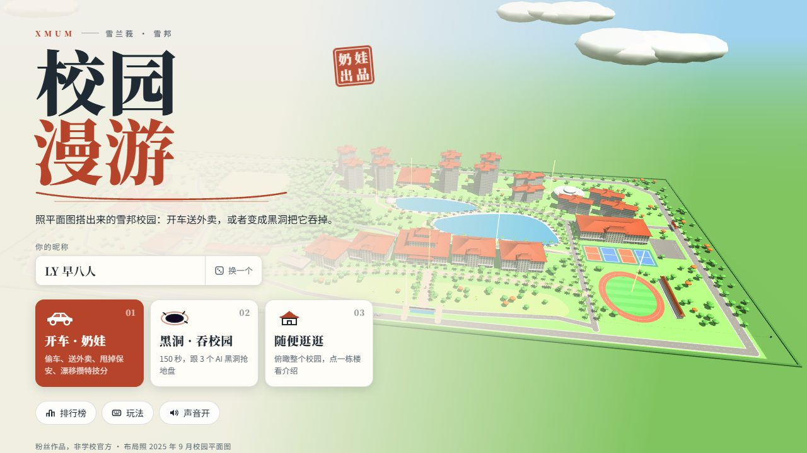
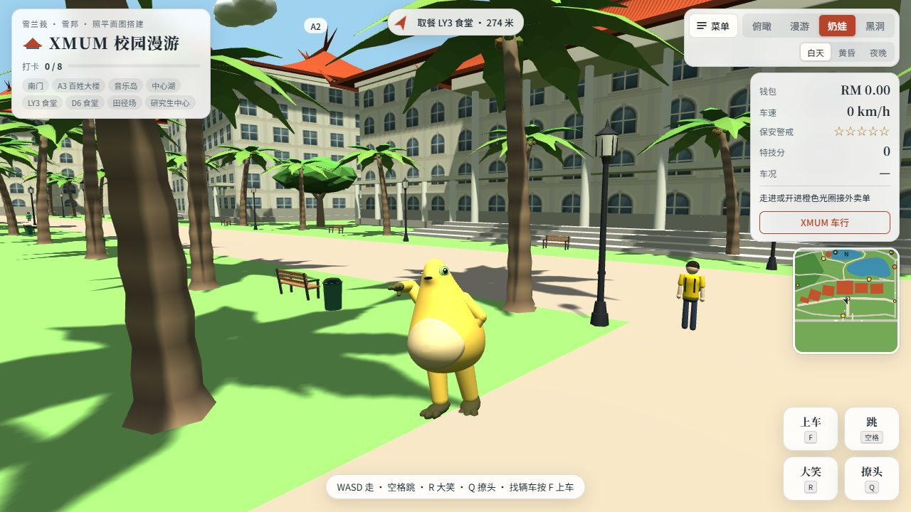
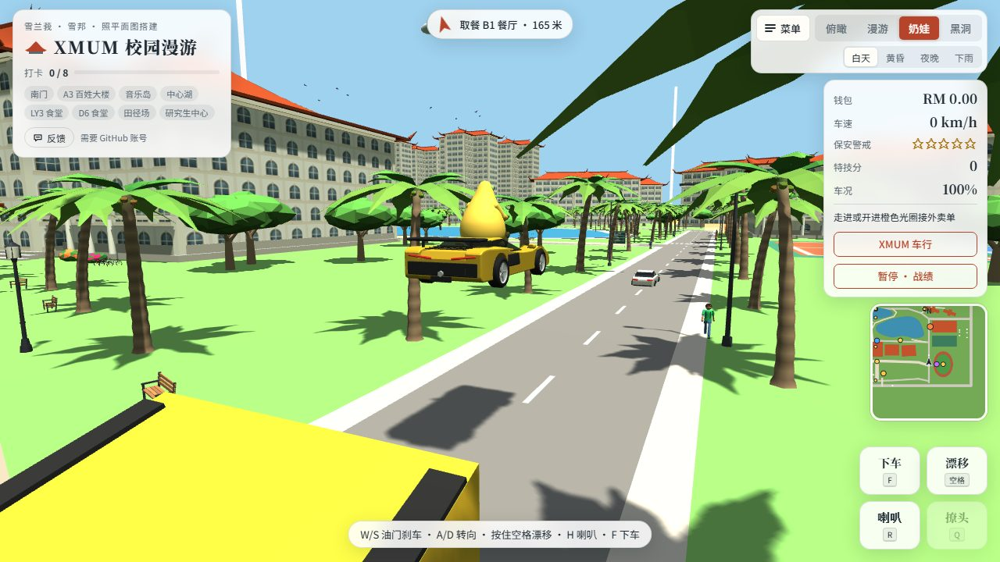
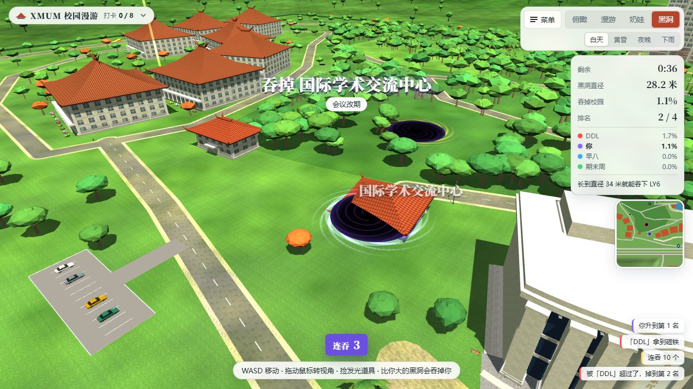
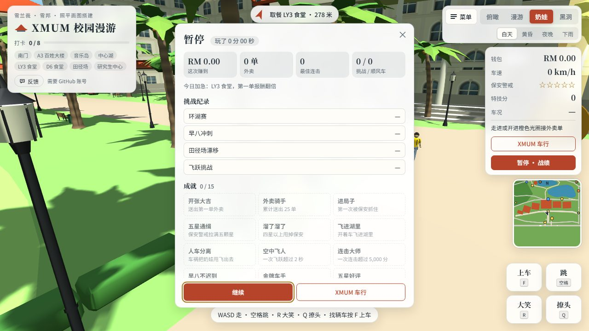
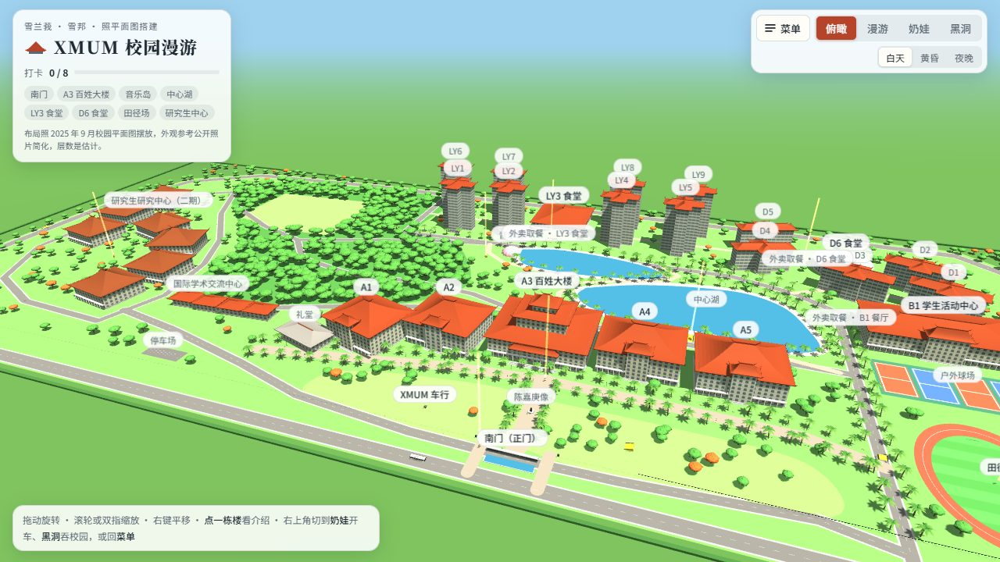
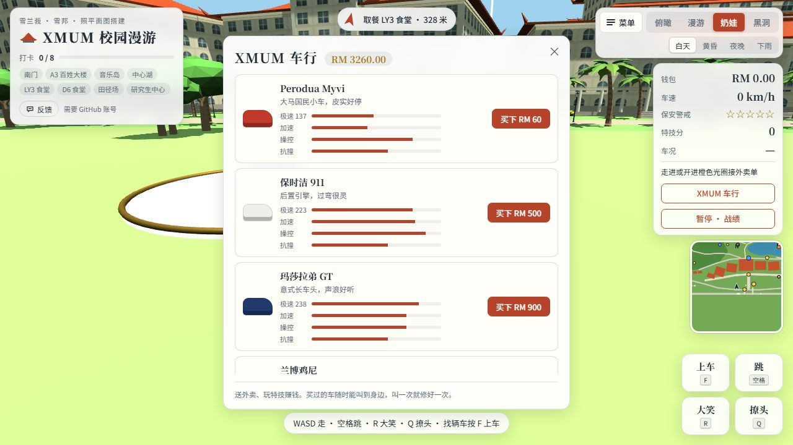
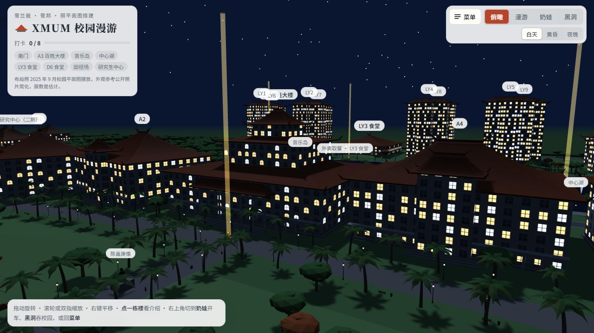
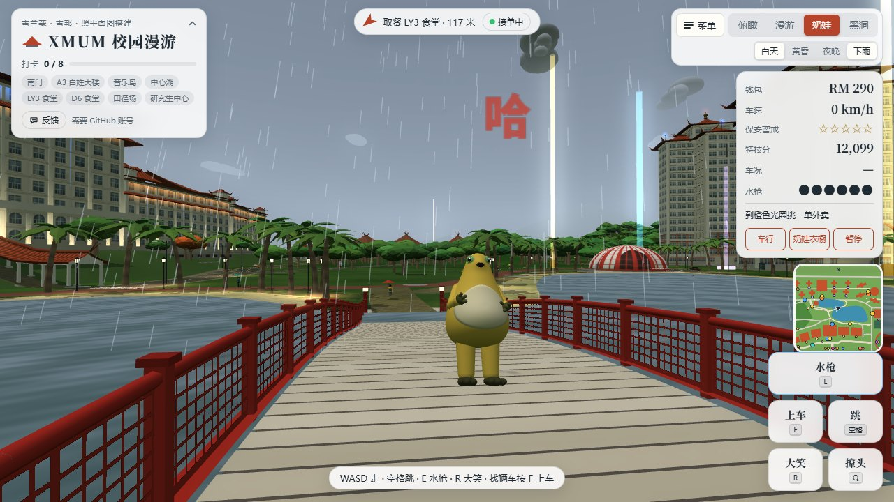

# XMUM 校园漫游

照着厦门大学马来西亚分校（XMUM）2025 年 9 月的校园平面图，用 Three.js 搭的一个 3D 校园小游戏。打开网页就能玩，不用安装，手机电脑都行，还能看到同时在线的同学、上全校排行榜。

### 👉 [点这里在线开玩：izhengjy.github.io/xmum-campus](https://izhengjy.github.io/xmum-campus/)

> 粉丝作品，不是学校官方项目。建筑外观根据公开照片简化，楼层数是估计。

[](https://izhengjy.github.io/xmum-campus/)

## 游戏截图

| | |
|---|---|
|  |  |
| **奶娃模式**：在 A3 百姓大楼前溜达，旁边走过去的是同学 | **开车**：开着兰博鸡尼冲上东边的跳台飞出去 |
|  |  |
| **黑洞 2.0**：和「DDL」「早八」「期末周」抢着吞树林 | **暂停面板**：按 P 看这局战绩、挑战纪录和成就 |
|  |  |
| **俯瞰**：照平面图摆的整个校园，点楼能看介绍 | **XMUM 车行**：送外卖、玩特技攒钱买车和改装 |
|  |  |
| **夜景**：一主四从和宿舍楼的窗户都会亮灯 | **午后阵雨**：会自己下，也能点「下雨」按钮 |

## 四种玩法

### 奶娃（GTA 风格）

奶娃在校园里走路、抢车、开车：

- **赚钱**：送外卖。每天有一单「今日加急」，第一单报酬更高。
- **追捕**：撞人、撞车会被保安追，警戒最多五星，躲一阵子就会消。
- **特技**：漂移、飞跃、惊险擦车都能攒特技分，连起来有连击倍数。
- **挑战**：走进发光的圈就能开始，按用时或分数拿金、银、铜牌。
  - 环湖赛
  - 早八冲刺：07:59 从宿舍出发，08:00 前冲到 A3
  - 田径场漂移
  - 飞跃挑战
- **顺风车**：载上赶课、晕车、拍视频的同学，开得好拿五星好评。
- **XMUM 车行**：用攒的钱买车。车名全是谐音恶搞，比如兰博鸡尼、玛莎拉弟 GT。还可以改装引擎、轮胎、防滚架。
- **成就**：15 个，暂停面板里能看进度。

### 黑洞 2.0

控制地上的黑洞，从小东西开始吞，越吞越大，最后能吞整栋楼：

- **对手**：和三个 AI 黑洞「DDL」「早八」「期末周」抢地盘，150 秒结算。
- **互吞**：比你大的黑洞会吞掉你。
- **道具**：地上有发光道具，分别是加速、磁铁、双倍、冰冻。
- **连吞**：连续吞东西有连击加成。
- **难度**：开局可以选轻松、普通、困难。

### 漫游

第一人称在校园里走，找 8 个金色打卡点。

### 俯瞰

转着看整个校园，点楼看介绍，可以「走到这里」。

### 校园环境

- 白天、黄昏、夜晚可以切换。
- 午后会下阵雨，有雨丝、积水和雨声，也可以点「下雨」按钮手动开关。
- 天上有飞鸟，草地上有校园小猫。

## 操作

**电脑**

| 按键 | 作用 |
|---|---|
| WASD | 走路、开车、移动黑洞 |
| Shift | 跑 |
| 空格 | 跳；开车时按住漂移 |
| F / Enter | 上车、下车（开太快下车会被甩飞） |
| R / Q / H | 大笑、撩头、按喇叭 |
| G | 打开 XMUM 车行 |
| P / Esc | 暂停，看战绩和成就 |

拖动鼠标转视角。

**手机**：左下摇杆移动，推到底是跑；右下按钮做动作；拖动屏幕转视角，俯瞰时双指缩放。

## 联机、排行榜和存档

线上版已经开了联机，数据存在 Firebase，服务器在新加坡。

- **在线玩家**：打开网页自动匿名登录，不用注册。在奶娃或漫游模式里能看到其他在线同学的奶娃、开的车和头顶的名字。
- **排行榜**：开场画面点「排行榜」，共四个榜。

  | 榜 | 比什么 |
  |---|---|
  | 黑洞 2.0 | 吞掉校园的百分比 |
  | 黑洞 1.0 | 旧版黑洞的成绩，已停止更新，留作纪念 |
  | 特技 | 特技分 |
  | 富豪 | 钱包 |

- **Google 登录和云存档**：开场画面可以「用 Google 登录」。登录后：
  - 钱、车、改装、成就、最好成绩会存到云端，换手机或电脑登录同一个账号就能接着玩。
  - 昵称也跟着账号走。
  - 不登录也能玩，进度只存在当前浏览器里。

想在自己 fork 的版本里开联机，按 [docs/FIREBASE.md](docs/FIREBASE.md) 配一个自己的 Firebase 项目。

## 反馈

发现 bug 或者有想加的玩法，点开场画面或游戏里的「反馈」按钮，选「报告 bug」或「提建议」，会在新标签页打开本仓库的 [新建 Issue](https://github.com/iZHENGjy/xmum-campus/issues/new/choose) 页面。

- **需要 GitHub 账号**：没登录的话，GitHub 会先让你登录或注册。
- **自动填好的信息**：游戏版本号、当前模式、设备和浏览器、屏幕尺寸。
- **不会带上的信息**：昵称、邮箱、账号。

## 如何参与

欢迎提 Issue 和 PR。为了不让大家白忙，请按下面的顺序来。

**没有 GitHub 账号？**
- 注册一个是免费的，用邮箱几分钟就好，注册后就能点游戏里的「反馈」。
- 不想注册的话，可以请有账号的同学帮你提，或者直接把问题和截图发给作者。
- 说清楚三件事就够了：在哪个模式、怎么操作出现的、看到了什么。

**想改代码、提 PR？**
1. **先开 Issue，说明你想做什么。** 可以选「提建议」，写清楚要改哪里、为什么。等作者回复同意再动手，免得花了很多时间，做出来的却是这个项目不打算要的功能。修小 bug（错别字、明显的显示问题）可以直接提 PR。
2. **从你 fork 的仓库开新分支，一个 PR 只做一件事。** PR 描述里写上对应的 Issue 编号（比如 `Closes #12`），以及你在什么设备、什么浏览器上测过。
3. **改了 JS 或 CSS，把 `index.html` 里所有的 `?v=` 版本号加一**，不然同学的浏览器会继续用旧缓存。
4. **本地测试别把测试成绩刷到正式排行榜。** 测之前把 `js/firebase-config.js` 里的 `window.XMUM_FIREBASE` 临时改成 `null`（单机模式），这个改动不要提交。
5. **不要提交密钥、个人信息，或者来源不明的图片和音频素材。**

`main` 分支只接受 PR，由作者测过再合并。

## 本地运行

需要一个静态文件服务器。直接双击 `index.html` 打不开，因为浏览器会拦截本地脚本。

```bash
python -m http.server 8000
```

然后打开 http://localhost:8000 。

## 代码结构

没有构建步骤，`index.html` 按顺序加载 `js/` 里的普通脚本，它们共享同一个全局作用域。每个脚本地址后面的 `?v=` 是缓存版本号，改了代码要加一。

| 文件 | 内容 |
|---|---|
| `js/00-core.js` | 渲染器、相机、材质、建筑生成器 |
| `js/10-world.js` | 地面、道路、湖、所有楼、植物、天空、昼夜 |
| `js/15-props.js` | 斑马线、路灯、巴士站、指示牌、旗杆、单车架等校园小品 |
| `js/16-ambient.js` | 午后阵雨（雨丝、积水、雨声）、飞鸟、校园小猫 |
| `js/20-fx.js` | 粒子、刹车痕、合成音效 |
| `js/30-naiwa.js` | 奶娃模型和动画 |
| `js/40-vehicles.js` | 跳台、车辆模型与物理、上下车、步行 |
| `js/50-missions.js` | 外卖任务、指南针、打卡 |
| `js/60-details.js` | 长椅、停车场、喷泉、学生 |
| `js/70-hole.js` | 黑洞 2.0：AI 黑洞、道具、连吞、难度 |
| `js/80-gta.js` | 保安追捕、特技连击、撞车判定、车行、改装、成就 |
| `js/85-activities.js` | 环湖赛、早八冲刺、田径场漂移、飞跃挑战、顺风车、擦车与慢动作、暂停面板 |
| `js/90-main.js` | 模式切换、输入、镜头、小地图、主循环 |
| `js/ui-title.js` | 开场画面、昵称、排行榜、Google 登录按钮 |
| `js/firebase-config.js` | Firebase 公开配置（填 `null` 就是单机） |
| `js/net.js` | 联机、排行榜、Google 登录和云存档（Firebase） |
| `js/feedback.js` | 「反馈」按钮：打开 GitHub 新建 Issue 页面并填好版本、模式、设备信息 |
| `css/style.css` | 全部界面样式 |
| `assets/audio/` | 奶娃笑声 |
| `database.rules.json` | Firebase 数据库安全规则 |
| `.github/ISSUE_TEMPLATE/` | 「报告 bug」和「提建议」两个 Issue 表单 |
| `test/shots.html` | 拍 README 截图用的离线页面，不连排行榜 |

## 致谢与声明

- [three.js](https://threejs.org/)（MIT）
- 字体：Noto Sans SC / Noto Serif SC（Google Fonts, OFL）
- 「奶娃」形象致敬原作者，游戏里的模型是用代码拼出来的低多边形二创，不是原作素材。本项目是非商业的粉丝作品，原作者如有异议请开 issue，我们会撤下。
- 奶娃的笑声剪自 B 站视频[《奶龙捧腹大笑原版》](https://www.bilibili.com/video/BV1auFZzaE4W/)（UP 主：坦克兵三哥小号）开头约 3 秒，仅作非商业二创使用，原作者如有异议请开 issue，我们会立即撤下。
- 车行里的车名都是谐音恶搞名，与任何真实汽车品牌无关。
- 校名、楼名仅用于还原校园，本项目与厦门大学马来西亚分校无官方关系。
