# 好友（`js/96-friends.js`）

联机时出现（`XNet.online`）。离线页面、预览版（离线）、连不上 Firebase 的玩家整套隐藏，不报错。
数据库规则还没发布（读写被拒绝）时，入口照样显示，面板里写「好友功能暂时不可用」，F 菜单里的「加好友」灰掉，别人的好友请求自动回「对方的好友功能暂时不可用」；每 2 分钟自己再试一次，规则发布后不用刷新就恢复。

## 怎么玩

| 做什么 | 电脑 | 手机 |
|---|---|---|
| 加好友（附近的人） | 好友面板右上角「＋ 加好友」（还没好友时直接显示），列出附近在线、还不是好友的玩家，点「加好友」 | 同左 |
| 加好友（4 米内） | 走到他旁边按 **F**，菜单里选「⭐ 加好友」 | 点他头上的「点我互动」，选「⭐ 加好友」 |
| 回应好友请求 | 邀请卡上 **F** 加 / **X** 不了 | 点卡片上的按钮 |
| 好友列表 | **Y**，或顶上「在线 N 人」旁边的「⭐ 好友」，或暂停面板右上角 | 「车行」「暂停」那一排的「⭐ 好友」，或暂停面板 |
| 去找好友 | 列表里「导航过去」，或大地图（M）上点粉色星星 | 同左；小地图点开大地图 |
| 解除好友 | 列表里「解除」，再点一次「确定解除？」 | 同左 |
| 关掉上线提醒 | 列表底下「好友上线时提醒我」 | 同左 |

- 列表：在线的排前面（正在导航的排第一）。在线的写大概在哪（用送外卖和大地图的地名：「在 D6 食堂」「Bell Suites 公寓 附近」「在校外」）、离你多远、开着什么车；离线的写「3 小时前在线」。
- 导航：指南针和小地图指着他（粉色的点），走到 15 米内算找到了；他下线 20 秒自动结束。挑战、小游戏这些自己的指南针目标优先。
- 上线提醒：同一个好友 10 分钟最多提醒一次；几个人一起上线合成一条，两条之间至少隔 20 秒。屏蔽了的人不提醒。
- 上限 50 个。请求限频：同一个人 60 秒一次，10 分钟最多 6 次；还有互动通道本身的限频（同一种邀请 8 秒一次、被拒以后 25 秒、一次只能等一个回音）。
- 屏蔽了的人：他的好友请求直接忽略（`js/96-social.js` 本来就丢掉屏蔽的人的邀请），你也不能加他。
- 第一次加上好友解锁成就「交个朋友」。
- 第一次有别的玩家走到 12 米内（不在剧情对话、过场里），提示一次「走近 XX 按 F 可以加好友」（手机：「点 XX 头上的『点我互动』可以加好友」）。
- 「附近的玩家」只有 `js/net.js` 本来就在收的附近几格里的人（大约 100–300 米），只写「就在你旁边」或「在附近」，不写位置；远处在线的人看不到，要走过去。
- 大地图只画好友（粉色星星）。以前大地图会把 3D 场景里所有名字标签都画上去，其中也有附近其他玩家头顶的名字，等于把没加好友的人的位置画在了地图上；现在 `js/90-main.js` 的 `miniNames` 跳过玩家名字（`data-net`）和表情气泡。3D 场景里附近玩家头顶的名字照旧（本来就看得到他们）。
- 游客（没用 Google 登录）也能加好友，好友跟着这台设备的匿名账号走；用 Google 登录的话换设备也在。

## 数据库

**改了 `database.rules.json`，需要重新发布规则。** 没发布之前读 `/friends` 会被拒绝，好友面板显示「好友功能暂时不可用」，其他照常。

| 路径 | 内容 | 谁能读 | 谁能写 |
|---|---|---|---|
| `/friends/{我}/{好友}` | `{n 名字, t 加好友的时间}` | 只有我 | 只有我；**新加**一条时要么对方的列表里已经有我，要么对方 10 分钟内给我发过请求（`/freq/{我}/{对方}`）。删除随时可以 |
| `/freq/{收件人}/{发件人}` | `{t}` 好友请求的凭证 | 没人（只给规则看） | 发件人写（同一对 30 秒一次）；收件人、发件人都能删 |
| `/fst/{我}` | `{n, t, p:"x,z"（10 米取整）, k 车型}` 给好友看的状态 | 我，和**我列表里的人** | 只有我 |

加好友的顺序（规则保证只有双方都同意才成对）：

1. A 发 `inv {k:'friend'}`（走 `/social` 通道），紧接着写 `/freq/B/A`。
2. B 点「加好友」：写 `/friends/B/A`（凭 `/freq/B/A`），删掉 `/freq/B/A`，回 `ans ok`。
3. A 收到 `ans ok`：写 `/friends/A/B`（凭 `/friends/B/A`），删掉 `/freq/B/A`。B 拒绝也删掉。

解除：删自己那条；对方在线就发 `ev {k:'unfriend'}`，他那边也删掉。对方不在线时，他下次打开列表读不到我的 `/fst`（规则拒绝），自己删掉（刚加 3 分钟内的不删，防止两边写入还没到齐）。

### 流量
- `/friends/{我}`：一直听着，只在加减好友时变。
- 在不在线：每个好友听一个 `/on/{uid}`（`js/net.js` 进游戏写、下线删）。`js/net.js` 本来就在听整个 `/on`，所以一般不多花流量。
- `/fst/{好友}`：**只在好友列表或大地图开着、或者正在导航去找他时**订阅，关了 8 秒后退订。好友在附近几格时直接用 `js/net.js` 的实时位置。
- 自己的 `/fst`：有好友时才写；挪了 60 米或换车才写（至少隔 30 秒），5 分钟一次心跳；断线时服务器把 `t` 改成断线时间（`onDisconnect`），好友看到的「最后上线」就准了。

## 接口：`window.XFriends`
```js
XFriends.active            // 联机、规则可用
XFriends.list              // [{uid, name, online, status}]
XFriends.isFriend(uid)
XFriends.open() / close() / toggle()   // 好友列表
XFriends.navTo(uid)        // 导航去找他；XFriends.nav 是正在找谁
XFriends.unfriend(uid)
XFriends.ask(uid)          // 发好友请求（他要在附近、在线）
```
`js/96-social.js` 为这个文件加了：`XSocial.addMenuItem({id, opt(p), pick(p)})`（F 菜单里加一项）、`XSocial.blocked(uid)`、`XSocial.why`（拒绝原因的文字）。

## 本地测试

不连任何服务器。项目根目录起静态服务器（例如 `python -m http.server 8770`），然后：

**一个人 + 本地假玩家**：`/test/social.html?bots&friends`
- 陪练小明：走过去按 F 选「⭐ 加好友」，他 1 秒后同意；司机阿华会婉拒。
- `&friends` 再放四个远处的假好友：KIP 购物中心走路的、Bell Suites 开兰博鸡尼的、两个离线的。看列表、大地图、导航。
- 控制台：`XFriendBots.ask()`（小明向你发请求，看邀请卡）、`XFriendBots.online('f3', true)`（让离线的上线，看提醒）、`XFriendBots.unfriend('a')`（小明解除）、`XFriendBots.seed()`。

**两个人互测**：两个浏览器窗口 `/test/social.html?p=a`、`/test/social.html?p=b`，走到一起按 F 加好友。一边控制台 `__mock.goOffline()` / `__mock.goOnline()` 看另一边的「刚刚在线」和上线提醒。

假数据库只模拟了两条规则：读 `/fst/{uid}` 要求 uid 的列表里有你（开始订阅时查一次）；加 `&nofriendrules`（或 `&oldrules`）时 `/friends`、`/freq`、`/fst` 全部拒绝，看「好友功能暂时不可用」。其他写入规则要用测试用的 Firebase 项目（`js/firebase-config.preview.js`）或 Firebase 控制台的「规则模拟器」测。

## 截图

| 电脑 | 手机 |
|---|---|
| 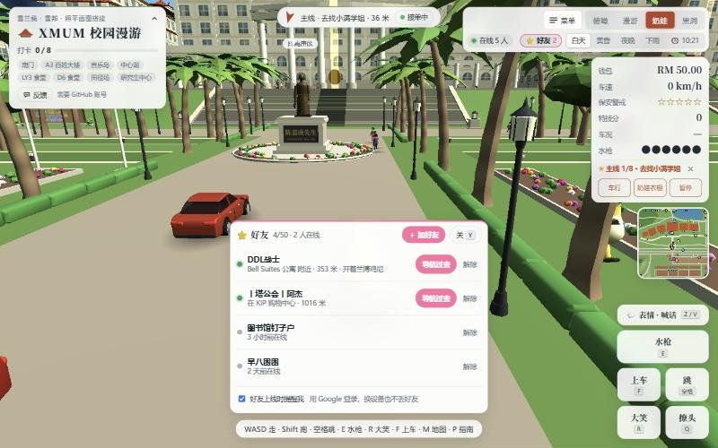 | 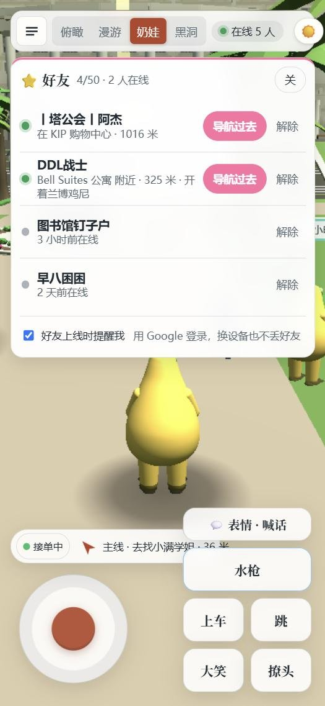 |
| 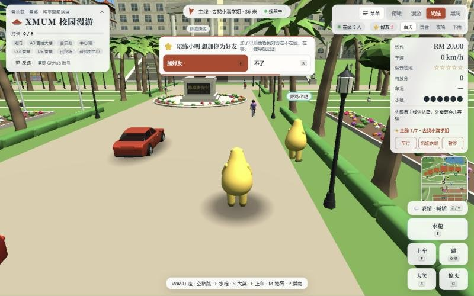 | 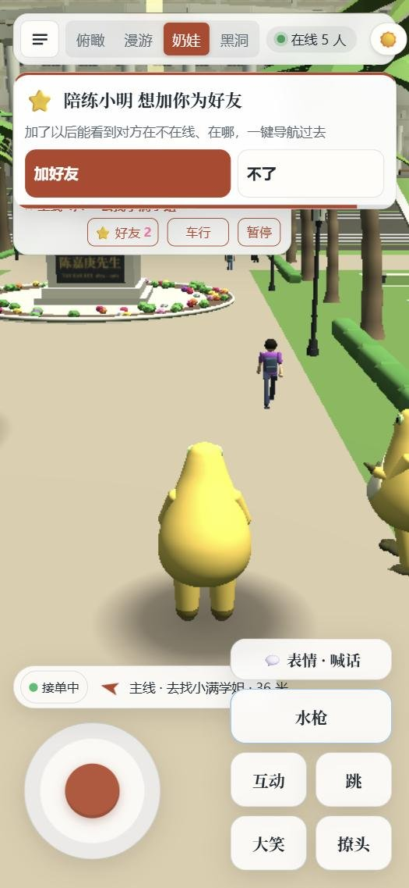 |
| 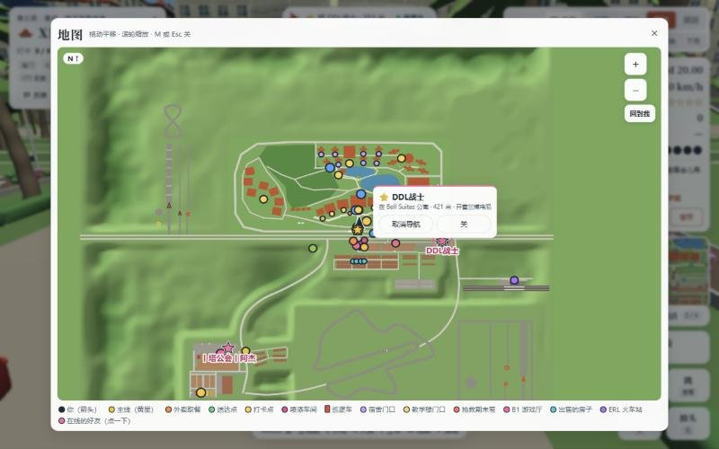 | 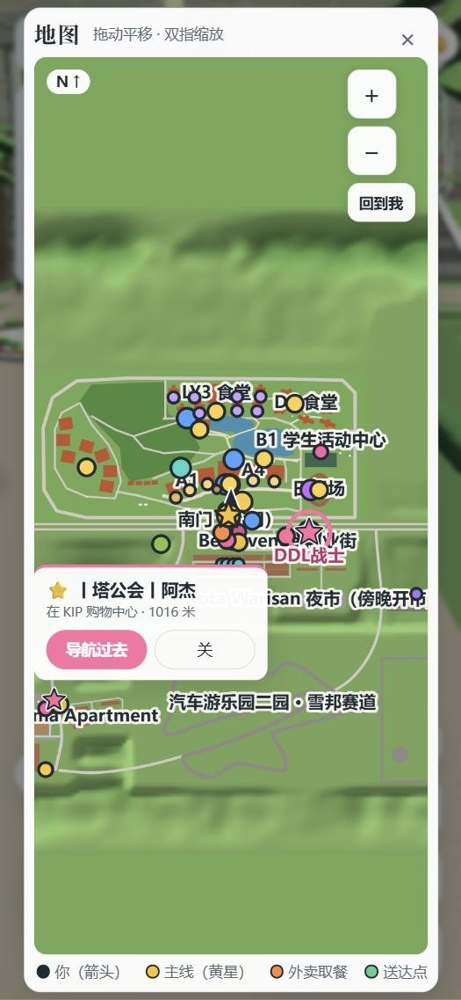 |
| 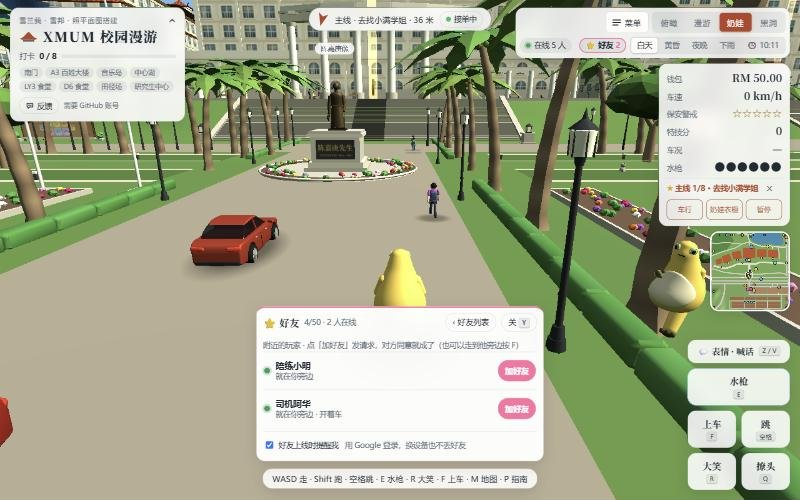 | 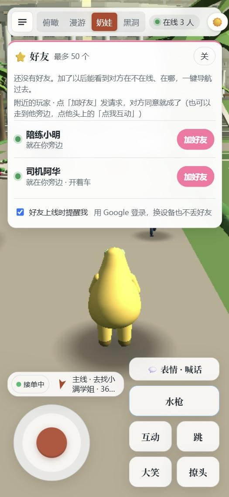 |
| 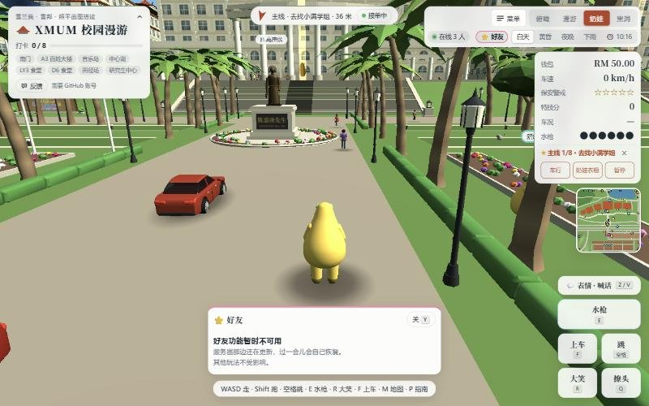 | 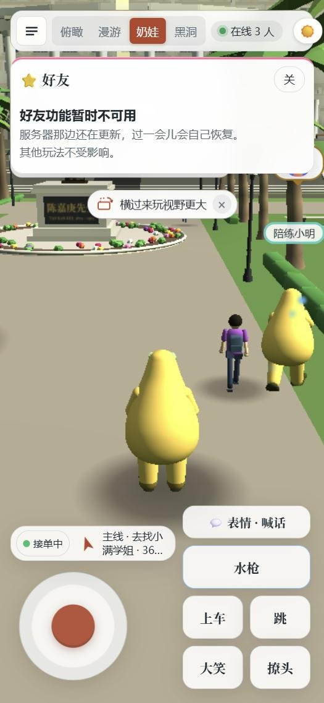 |
| 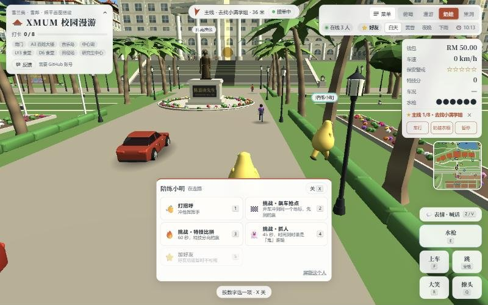 | 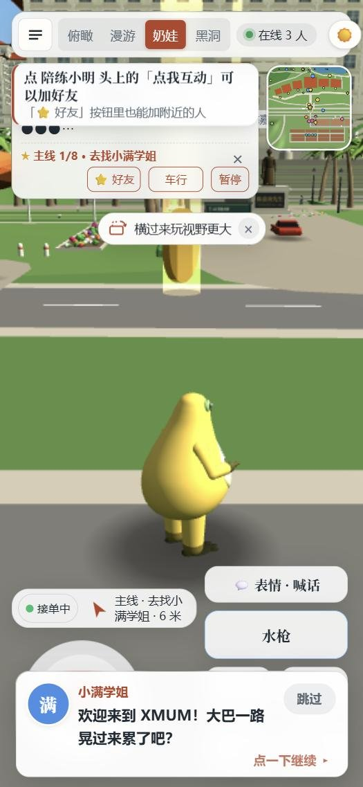 |
| | 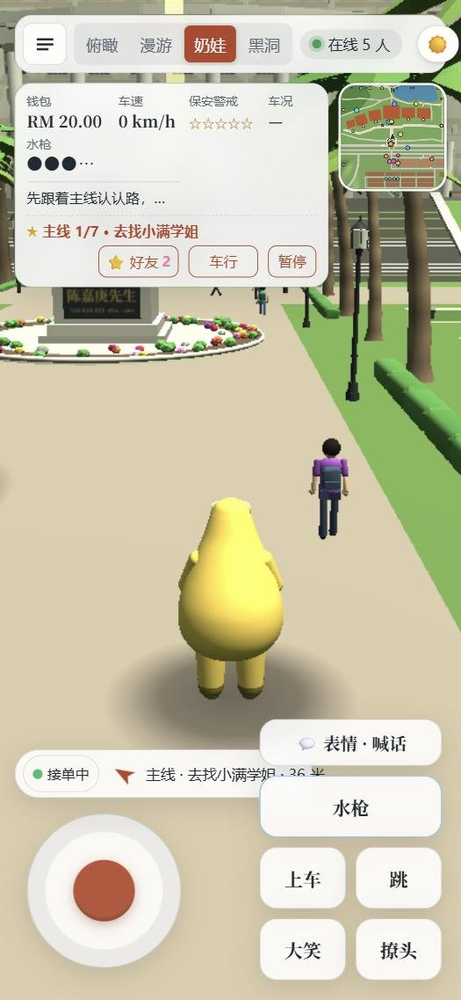 |
