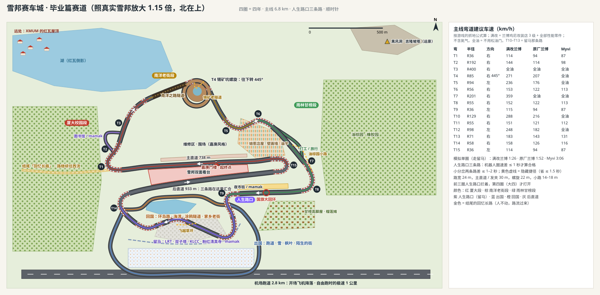

# 雪邦赛车城 · 设计方案（毕业篇：四圈，四年 · 两倍还原雪邦）

> 状态：**方案，等仓库主人说「可以」再动手。** 这一轮只有文档、赛道俯视图 `docs/sepang-track.svg` 和一个手感原型 `proto/sepang.html`，没有改任何游戏代码。
>
> 主人的原话（2026-11-12，按时间顺序）：
> - 「可以开始构建雪邦 f1 赛道的地图了，需要边跑边包含吉隆坡的元素，双子塔，独立广场，粉红色清真寺……还可以设计不同的天气，突发情况，猴子上道。各种 360 度回旋跑道……粒子效果要做好。要让我们的车开的舒服开的爽」
> - 「如果可以的话，就按照雪邦 f1 的赛道为基础」
> - 「甚至可以不同风格转变，赛博朋克，卡通等等」；要「电影级效果」
> - 「其实就是看故事为主，爽为主」
> - 「可以出现不同的道路选择，捷径等」；「道路选择可以映射到我们真实的选择，毕业后是出国？回国？两条路的风景不一样」；**已定：留马单独做第三条路**
> - 「故事的结尾一定要有深度，路在当下什么什么的」；「我是原地不动的，但是场景是向着我流过来的感觉？而且是全屏，360 度，真的是看电影」
> - 「一个大学生的四年，有很多回忆。亲情，友情等等，自己生病自己扛，一个人吃饭等等，你大胆想象」
> - **已定：「这个篇章，可以要求手机玩家用电脑玩。我就要最好的展示」**；「如果有必要，可以考虑用其他引擎什么的，我要最好的」
> - 「多一点马来西亚和厦门大学的元素」
> - **「雪邦赛道我是打算只一个人单机玩，为什么不大胆一点，直接两倍赛道还原？」**（定为主要方向）
> - **「我不是很想要卡通的，我想要有质感的，副驾有没有对白。还可以加一点竞争对手。」**

## 一句话

**这不是一张赛车图，是大学四年的缩影。** 一场比赛跑四圈，一圈一年。**赛道是真实雪邦的走向、整体放大两倍（一圈 10.9 km、路宽 30 米），单机**：12 个弯满改跑车能 225 km/h 以上压过去，两条 1.6 km 的直道上能开到 600 km/h，只有三个发夹还要重刹。主赛道永远是纯还原的雪邦（计时赛和排行榜只跑它）；故事里的东西都是岔出去再并回来的支线。一圈分成四段：厦大校园段、南洋老街段、雨林甘榜段，第 4 圈到了**人生路口：出国、回国、留马三条支线**，三条路最后汇合到同一条后直道、同一个终点。副驾驶每圈换一个人：爸爸、阿明、空座、朋友们。冲线以后车停下来，进入「人不动、路向你流过来」的 360° 电影段落：四年的回忆从前方流过来，在身后远去。最后一句：「路在当下。」

技术上推荐**单独一页 `/sepang/`，用新版 Three.js（ES 模块、不需要构建步骤）加 pmndrs `postprocessing`**，只给电脑玩，手机上给一张邀请卡。主游戏只负责「坐飞机进出」和记账（钱、材料、排行榜）。

画面**全程写实、有质感**（不做卡通），四年的情绪靠光、天气和调色来分。副驾驶有对白（字幕为主），每场还有三个有名有姓的对手：稳的林学长、激进的 Hafiz、会别车的黄少。

**下一步**：先做一个 30 秒的画面 demo（第 7.4 节），主人看了再往下做。需要主人拍板的三件事见文末。

---

## 1. 故事

### 1.1 基调（主人已确认）
- 大多数 XMUM 同学离家来马来西亚读书，一开始什么都陌生，后来这里变成了第二个家。沿途的双子塔、粉红清真寺、油棕园、mamak 不是景点，是「我们的地方」，边开边认出来。
- **速度感 = 年轻**：大学过得很快、很爽、很自由。
- **突发情况 = 生活本身**：暴雨、烟霾、猴子冲出来，是一路上的意外和笑点，不是惩罚。
- **三岔路口**：每个人迟早要面对，没有标准答案；一起开车的朋友到了路口各走各的。
- **终点**：三条路汇合到同一个终点：大家都是从同一个地方出发的。
- 整体：爽、热闹、好笑，到路口突然安静一下，有点舍不得，然后继续踩油门。**不煽情过头，但开完会想起自己的大学。**
- **爽是硬标准**：不难、不卡关、不罚人。冲出去 1 秒内自动回到赛道（故事模式不罚时）；失败了马上重来；突发事件是惊险不是坑人。

### 1.2 放在时间线的哪里（**请主人拍板**）
现在的主线只写到大一（八章 + 「大一收尾」过场和「我的大一」回顾卡）。四圈四年讲的是整个大学，所以要选一个「站在哪里回头看」的位置：

| 选项 | 怎么进 | 好处 | 坏处 |
|---|---|---|---|
| **A. 毕业篇（推荐）** | 「大一收尾」之后解锁。小满学姐发来消息：「Ben 师傅的车队在雪邦办毕业告别赛，你来吗？」四圈是比赛，也是快进的四年 | 站在毕业回头看最自然；「路在当下」是毕业时最有分量的一句话；不影响以后再写大二、大三主线 | 时间上跳了三年，需要一句字幕交代「快进到四年后」 |
| B. 大一结束后的一场梦 | 「我的大一」回顾卡之后，在宿舍睡着 | 不用跳时间线 | 梦削弱了「路在当下」：结尾说「当下」，前面却是梦 |
| C. 主线第 9 章 | 接在第 8 章（带新生阿豆）后面 | 主线连贯 | 主线是必经的，但这一章只给电脑玩，手机玩家会被卡住 |

推荐 A，并且它是**可选的高潮章节**：主线从来不要求打它；「下一个目标」会推荐它，但手机上永远不会因为它卡住。

### 1.3 结构：四圈 = 四年
人物都用主线里已有的：小满学姐、站长老周、室友卷卷、Bell 嘛嘛档的阿明、他的表哥 Ben 师傅（车队老板，你的「雪邦赛道涂装」就是他车队的旧涂装）、新生阿豆、宿舍走廊的小橘、妈妈（主线里一直在发消息）。

| 圈 | 年 | 副驾驶 | 时间 / 天气 | 风格 | 这一圈的感觉 |
|---|---|---|---|---|---|
| 1 | 大一 | **爸爸**，一路不说话，只是帮你拎箱子 | 早上，晴，热 | 写实，颜色偏亮偏饱和（什么都新鲜） | 陌生、兴奋。路口的三条路都还拦着：「还早。」 |
| 2 | 大二 | **阿明**，吵吵闹闹 | 下午，阵雨 | 写实，午后侧光，雨后路面像镜子（笑点最多的一年） | 最好笑的一圈：猴子抢东西、在 mamak 看球、第一次穷游 |
| 3 | 大三 | **空座**，安全带扣着 | 夜里，暴雨转烟霾 | 写实偏冷；发烧那段是**雨夜霓虹的梦**（真实的霓虹灯管，不是卡通） | 一个人扛的一年。难过但不卖惨，车照样开得爽 |
| 4 | 大四 | 朋友们**各开各的车**，和你并排跑 | 傍晚，雨后放晴，金色阳光 | 写实，暖色，Bloom 最强 | 热闹到路口，安静一下，各走各的，再在后直道汇合冲线 |

> 为什么第 4 圈不是「挤满整辆车」：玩家的车大多是两座跑车。改成朋友们开着自己的车（卷卷的 Myvi、阿明的车、阿豆的小摩托）组成车队和你并排跑，一路按喇叭，到了路口打着双闪各自拐走，画面比挤在车里更好，也更符合「各走各的」。

### 1.4 人生路口：出国、回国、留马（主人已定三条）
- 位置：第 9 号弯出弯后（大回环下坡之后）。前三圈三条支线的入口拦着路障，路障上写「还早」「再想想」「先把今年过完」，大家照常跑雪邦原来的 T10–T13。**第 4 圈**反过来：原来的 T10–T13 被看台观众和旗手拦住（「比赛跑完了，选一条你的路」），三条支线打开，**都不是原来那条**，所以没有哪条是「默认的路」。三条支线最后都并回 T14（第 2.5 节）。
- 路口前 300 米：音乐收掉，只剩引擎声和风声；朋友们的车依次打双闪。卷卷摇下车窗喊一句，阿明按两下喇叭，阿豆骑着小摩托在路边挥手（他还在读书，「学长，我还在这条路上」）。
- **朋友们的选择**（暂定，主人可以改）：卷卷 → 出国（读研）；阿明 → 留马（他本来就是马来西亚人：「对我来说，这叫回家」）；小满学姐 → 回国（她早一年毕业，在回国那条路上的家乡街口等你，如果你也走这条）。
- **不评判**：三条路的圈速差 ≤ 1 秒（机器人跑过才能合并）、奖励相同、各有各的爽点；文案温和，不暗示哪条更好。
- 选过的路记下来；通关之后自由跑每圈都能换一条，「看看另一种人生」。

| | 出国 | 回国 | 留马 |
|---|---|---|---|
| 路线 | 中圈（约 4.5 km）：冲上机场跑道，再穿过陌生的城市 | 内圈（约 3 km，弯最多）：海湾边的公路、隧道，再进家乡老街 | 外圈（约 6 km，最快）：高速公路开进远处的吉隆坡天际线，再绕城外的高速公路回来 |
| 风景 | 机场跑道、起飞的客机、雪、枫叶、陌生的街景和多语言路牌、有轨电车 | 海湾边的公路、海湾里鼓浪屿式的小岛、厦门环岛路和白城沙滩、芙蓉隧道式的涂鸦隧道、上弦场、建南大会堂式的大楼；然后是家乡的老街：早餐摊冒热气、红灯笼、小区门口 | 吉隆坡上班族的日常：高架上的 LRT、通勤车流、真实高度的双子塔、KLCC 公园、独立广场、深夜的 mamak |
| 天气 / 色调 | 冷色、下雪（只有这一段下） | 暖黄、细雨后的傍晚 | 热带金色傍晚，城市灯一盏盏亮 |
| 音乐 | 管弦、空旷 | 古筝 + 流行 | 本地流行 + 一点马来乐器 |
| 爽点 | 极速（跑道上开氮气） | 隧道里的回声和连续 S 弯 | 双子塔中间的高架、LRT 并排跑 |
| 旁白（一句，克制） | 「我想去更远的地方看看。」 | 「家里的灯一直留着。」 | 「这里也是家。」 |

### 1.5 一路上的回忆（不打断驾驶）
- **手机通知**：HUD 一角偶尔弹一条，不用操作，一闪而过。例：「妈妈：吃饭了没？」「妈妈：（60 秒语音）」「准证还有 30 天到期」「Due：明早 9:00」。
- **路边回忆小场景**：亮着灯的宿舍窗口、只有一个餐盘的双人桌、诊所门口、走廊上的小橘、生日那天宿舍门口的蛋糕外卖。快的时候一闪而过，慢下来才看得清；每个场景只出现在对应的那一圈。
- **天气对应情绪**：大二的阵雨是好玩的（和阿明淋成落汤鸡），大三的暴雨是生病那一周，大三后半的烟霾是迷茫，大四雨后放晴。
- **素材怎么分到四圈**（从建议素材里挑，取舍过，不卖惨）：

| 圈 | 亲情 | 友情 | 一个人 |
|---|---|---|---|
| 大一 | 爸爸拎箱子；行李箱里妈妈塞的腊肠和辣酱（过海关那段一个担心的表情） | 卷卷第一次抓着你喊「救命」（期末周） | 第一次自己去 KIP 买东西 |
| 大二 | 生日那天家里远程点的蛋糕外卖送到宿舍门口 | 凌晨两点的泡面赶 due；在 mamak 看球；和阿明穷游槟城（南洋老街段的壁画墙） | — |
| 大三 | 「吃饭了没」→「吃了」（其实没有）；视频前把房间收拾干净 | 开学时的室友转学了，空着的床 | 发烧 38.9℃，自己叫 Grab 去诊所，用不熟的英语说症状；回来煮粥，跟家里说「挺好的」；食堂里一个人坐双人桌；半夜热水器坏了 |
| 大四 | 回家发现爸妈又老了一点，家里的狗愣了一下才认出你 | 最后一顿饭，大家说「以后常聚」 | 考完最后一门走出考场，突然觉得很空 |

### 1.6 结尾：路在当下（完整分镜）
1. **冲线**（0–6 s）：三条路在后直道汇合，朋友们的车从两边并进来，一起冲过嘉庚风格的终点门楼。慢动作 1.5 秒，彩带、烟火、看台上的人喊「Merdeka!」。
2. **停不下来的那一段**（6–12 s）：别人都在终点区停了，你的车继续往前滑，路没有到头：主直道的延长线往西，朝远处 XMUM 的红瓦屋顶开过去。音乐只剩一把吉他。
3. **人不动，路流过来**（12–60 s，第 7 节）：画面变成宽银幕，车停在原地，路开始向你流过来。玩家可以用鼠标 360° 环顾。回忆按四年的顺序从前方流过来、从身边经过、在身后远去：爸爸放下箱子的背影、阿明在 mamak 举着拉茶、空着的副驾驶、诊所门口、小橘、四个人的最后一顿饭、考场门口。回头看，走过的路还在身后，越来越远。
4. **安静**（60–70 s）：流动慢下来，停住。前面是一个普通的路口，红灯。副驾驶空着，安全带扣着。
5. **最后一句**（70–80 s）：三个版本，请主人挑一个：

| 版本 | 画面 | 台词 / 字幕 |
|---|---|---|
| **一（推荐）** | 黑屏。手机「叮」一声 | 妈妈的语音：「吃饭了没？」你打字：「吃了。」这次是真的。字幕：「**路在当下。**」 |
| 二 | 红灯变绿。车往前开，镜头不跟，留在原地 | 字幕：「后来的路，都是从这里开出去的。」 |
| 三 | 镜头慢慢移到空着的副驾驶，安全带扣着 | 没有台词。字幕只有一行日期：毕业那天 |

6. **「我的选择」回顾卡**：和现有的「我的大一」回顾卡（`js/89-yearend.js`）同一种做法，1080 × 1440 的一张图，能下载、能分享：四圈四年各一句、你在路口选的路、朋友们各自的路、最快圈、走过的捷径、最后一句话。

### 1.7 故事节拍 × 赛道位置 × 镜头 / 特效
（赛道位置见俯视图；「段」是一圈里的四段，每圈都会经过。）

| 圈 | 位置 | 节拍 | 镜头 / 特效 |
|---|---|---|---|
| 开场 | 赛车城机场 | 飞机降落在跑道上，你的车从货舱开下来；Ben 师傅：「四圈，一圈一年。」 | 航拍飞越全图（起点 → 螺旋 → 路口 → 终点），倒数时车灯和轮胎特写 |
| 1 | 起点 · 厦大段 | 爸爸坐在副驾驶，箱子在后面；嘉庚门楼「欢迎新生」 | 明亮色调；通知「妈妈：到了没？」 |
| 1 | 南洋之路隧道 | 下南洋那一代人的老照片在隧道墙上流过：码头、锡矿、橡胶园、店屋，出隧道是今天的 XMUM | 隧道里色调变成旧照片的棕色，出口一下子亮 |
| 1 | 人生路口 | 三条路拦着：「还早。」 | 普通 |
| 1 | 冲线 | 爸爸第一次开口：「到了就好。」 | 爸爸下车，拎着空了的手 |
| 2 | 南洋老街段 | 阿明：「槟城的壁画墙！停车拍照！」（不停也没事） | 午后侧光，云影在路上移动 |
| 2 | 雨林甘榜段 | **猴子上道**，抢走阿明手里的面包（笑点） | 慢动作 0.8 秒 + 侧拍 |
| 2 | 油棕园小路（隐藏捷径） | 阿明：「跟我走这边！」带你发现第一条捷径 | 成就「阿明的路」 |
| 2 | 后直道 | 阵雨，两个人淋成落汤鸡还在笑 | 雨幕、轮胎水雾、挡风玻璃雨滴 |
| 3 | 起点 | 副驾驶空了。通知：「准证还有 30 天到期」 | 冷色，暴雨 |
| 3 | 南洋老街段（夜） | 诊所的灯牌；**发烧 38.9℃，进入雨夜霓虹的梦**：店屋往上叠得看不到顶，招牌全是霓虹灯管 | 声音像隔着水、时间慢 10%、色差；湿路面倒影；Bloom 加强 |
| 3 | 雨林甘榜段 | 梦醒，烟霾。一个人坐在 mamak 看雨的场景一闪而过 | 雾的层次，能见度 300 m |
| 3 | 冲线 | 「吃饭了没？」→「吃了。」 | 安静，没有烟火 |
| 4 | 起点 | 朋友们的车在起跑线排成一排，阿豆骑摩托在旁边 | 发车倒数特写；暖色金光 |
| 4 | 大回环 | 全队一起转回环 | 环绕镜头 + 慢动作 |
| 4 | 人生路口 | 路障打开。音乐停。朋友们打双闪，各自拐走 | 镜头从高处拉开看三条路分开 |
| 4 | 出国 / 回国 / 留马 | 各自的风景和一句旁白 | 每条路自己的色调和音乐 |
| 4 | 后直道 | 三条路汇合，朋友们从两边并进来 | 慢慢升起的音乐 |
| 结尾 | 终点 → 回忆长路 | 第 1.6 节 | 宽银幕、360° 流动 |

---

### 1.8 副驾驶的对白（有，字幕为主）

**有对白。** 副驾驶是这一章的情感主线，但要少而准：一圈 2–3 分钟，**每圈 8–12 句**，大部分时间让引擎声和音乐说话。

**什么时候说**（游戏里实时触发，同一类话 20 秒内不重复，刹车区和发夹里只说 4 个字以内的短句）：

| 时机 | 怎么判断 | 例 |
|---|---|---|
| 剧情点 | 到了这一圈的固定位置（第 1.7 节的表） | 每圈 3–4 句，必说 |
| 过弯 | 刚出一个快弯，或者擦胎减速超过 1 秒 | 夸你，或者吓一跳 |
| 超车 / 被超 | 和对手的名次变化 | 对手相关的话（第 1.9 节） |
| 路口 | 第 4 圈人生路口前 300 m | 只在第 4 圈 |
| 天气变化 | 开始下雨、起烟霾、雨停 | |
| 撞车 / 冲出去 | 撞墙、复位 | 安慰或者笑你，不说教 |
| 冲线 | 每圈冲线 | 一句收尾 |
| 安静太久 | 30 秒没人说话、直道上 | 闲聊一句（第 3 圈例外） |

**怎么呈现：推荐「字幕 + 环境声」，不用现在的「叽叽咕咕」。**
- 字幕：屏幕下方居中，名字小一号，白字带淡淡阴影，句子整句淡入，按字数停 2–4 秒。过场里是宽银幕下方的电影字幕。
- 主游戏的 `XVoice`（`js/89-cine-audio.js`）是每个角色一个音高的「叽叽咕咕」，适合校园的轻松过场，但放在这一章写实、有质感的画面里会显得卡通，所以这一章**不用**它。说话的时候改成：音乐压低一点、车里的环境声（空调、雨刷、转向灯）更清楚，让人「感觉」到有人在说话。
- **真人配音（可选，第二期）**：游戏里做不了 TTS（机器声更出戏）。如果主人或同学愿意录，每个角色十几句，压成很小的音频文件放进仓库，比任何合成都有感情。没有录音时就只有字幕，效果也完整。

**每圈的示例台词**（克制、像真人说话，不煽情）：

**第 1 圈 · 爸爸**（一路话很少，越少越好）
- 起步：「慢点开。」
- 过第一个快弯：「……你什么时候学会开这么快的。」
- 南洋之路隧道：「你太爷爷那辈，也有人坐船来过这边。」
- 下雨或擦胎：「不急。」
- 冲线：「到了就好。」（然后下车，拎着空了的手）

**第 2 圈 · 阿明**（话多，马来西亚华人的口气，中文里夹一点马来文和英文）
- 起步：「Wei，你这车跟我借的那台比，哪个快？……好啦好啦，你的快。」
- 猴子上道：「我的面包！！那只猴子跟了我三个学期了！」
- 超车：「漂亮！今晚 mamak 我请，拉茶 kurang manis。」
- 阵雨：「Hujan lagi。三点下雨，四点就晴，你习惯了没？」
- 油棕园小路：「跟我走这边！这条路只有本地人知道。」
- 冲线：「明年还坐你的车。说好了。」

**第 3 圈 · 空座**（「没有人说话」本身就是这一圈的对白）
- 副驾驶的安全带扣着，座位上没有人。
- 车载电台自己换台：先是一段马来语的路况播报，然后是一首慢歌，雨大了以后只剩雨声和雨刷。
- 手机通知代替说话（HUD 一角，一闪而过）：「妈妈：吃饭了没？」「准证还有 30 天到期」「Due：明早 9:00」「Grab：司机已到达诊所门口」。
- 只有一句字幕，是你自己的，在发烧那段的霓虹梦里：「……其实我有点想家。」
- 冲线时回复妈妈：「吃了。」

**第 4 圈 · 朋友车队**（用车上的对讲机，像车队无线电，带一点电流声的质感）
- 发车前，卷卷：「最后一圈了，谁慢谁请客。」
- 阿明：「我先说好，我不让你。」
- 大回环，阿豆（骑摩托在路边）：「学长！帅！」
- 人生路口前，卷卷：「我往这边了。到了给你发消息。」阿明：「Jumpa lagi，兄弟。」然后对讲机里只剩电流声。
- 后直道三条路汇合，对讲机又响起来，三个人同时说话，听不清，但都在笑。
- 冲线：没有人说话，只有看台的「Merdeka!」

### 1.9 竞争对手（有名有姓，各有性格，打得爽）

除了一起开车的朋友，每场还有三个**对手车手**（虚构人物），每个人的开法不一样，和四年也连在一起：

| 对手 | 是谁 | 开法（AI 风格） | 和故事的关系 |
|---|---|---|---|
| **林学长 Kelvin** | 大四学长，XMUM 赛车社社长 | **稳**：永远走最干净的线，几乎不犯错，速度是建议车速的 98%，不别车 | 第 1 圈他从外侧超过你：「欢迎来到 XMUM。」是你四年一直在追的人。第 4 圈他已经毕业了，站在人生路口挥旗，看到你说：「轮到你了。」 |
| **Hafiz** | 隔壁大学车队的王牌，马来同学 | **激进**：刹车最晚，喜欢从内线硬塞；偶尔锁死冲宽（这是你超他的机会） | 第 2 圈开始的宿敌，阿明一看到他就开始放狠话。每次你超过他，他在对讲频道里只说一个词：「Lagi.」（再来）。第 4 圈冲线后第一个过来和你击拳 |
| **黄少 Jason** | 车行老板的儿子，开最贵的车 | **会别车**：直道上左右挡你的尾流（每次只换一次线，守规矩），下雨天心态会崩、会自己打转 | 笑点担当。第 2 圈下雨时他在 T9 打转，阿明笑到咳嗽。第 4 圈他在路口难得认真：「我爸让我回去接车行。……你呢？」 |
| **「去年的自己」** | 你上一圈的影子车（半透明） | 就是你自己 | 第 2–4 圈都有：你在和「大一的我」「大二的我」比。第 3 圈三个对手都不来（那一年只有你自己），只有这辆影子车陪着你 |

**难度要爽、不挫败**：
- **橡皮筋**：落后时对手稍微松一点，领先时稍微追一点。每圈结束时你离第一名永远不超过约 3 秒；只要不出大错，最后一圈总有机会赢。
- **对手的失误是故意设计的超车机会**：Hafiz 在 T1 / T9 / T15 偶尔冲宽，Jason 雨天会打转，第 4 圈 Kelvin 已经毕业、不在场上。
- **故事不看名次**：赢了、输了都能往下走，只是赛后那句话不一样（赢了 Hafiz：「Lagi.」；输给他：「明年。」）。
- **撞车不罚人**：碰到对手，他们会让开一点，不会被撞飞、也不会把你撞飞。
- **设置里能调**：对手强度「轻松 / 正常 / 认真」，默认正常。

**赛后和宿敌**：
- 每圈冲线后，在维修区的通道里有 2–3 秒的赛后一句（字幕，不打断）。
- 记下和每个对手的胜负（例如「对 Hafiz 3 胜 1 负」），写进「我的选择」回顾卡。
- **排行榜和影子车**：计时赛里可以选「和对手的影子跑」。三个对手各有一条设计好的圈速，当成奖牌线：铜 = Jason，银 = Hafiz，金 = Kelvin（按车的级别换算）。排行榜上真实玩家的影子照旧（`js/92-racing.js` 的影线）。

---

## 2. 赛道：真实雪邦，两倍大（主人定的方向）

> 主人：「雪邦赛道我是打算只一个人单机玩，为什么不大胆一点，直接两倍赛道还原？」
> 按这个做：**主赛道 = 真实雪邦的走向，整体放大 2 倍，一圈约 10.9 km**；只有自己加上 AI 或影子车，不做联机同步。

### 2.1 先算车：现有跑车在赛道上能过多急的弯
读的代码：`js/40-vehicles.js` 的 `updateCar`（基础物理）、`js/94-f1-drive.js`（注册过的赛道上的手感）、`js/80-gta.js` 的 `tunedT` / `UPG`（车行改装店 3 级）、`js/42-tuning.js` 的 `perf` 字段和 `js/93-tuning-ui.js` 的 `tnTuned`（改装车间性能零件）、`js/94-tuning-drive.js`（氮气）。

- 基础物理**没有抓地极限**：方向打满在任何速度都能急转。
- 赛道上（`XF1D`）有抓地极限：侧向抓地 `a0 = 13 × (抓地/8.2)^0.6` m/s²，下压力 `× (1 + 0.6 × min(2, (v/50)²))`；建议车速按 1.2 倍抓地算，方向盘上限按 1.35 倍，再快就自动「擦胎减速」。
- 极速：主游戏的赛道上 360 km/h 以上的部分打对折；氮气 `极速 × (1 + 威力)`、`加速 × (1 + 3.2 × 威力)`。
- 加速和刹车都非常猛（满改兰博加速 56 m/s²，刹车是加速的 2.4 倍），**一圈的快慢几乎全看弯道车速**。

| 车 | 抓地 | 侧向抓地 a0 | 极速 |
|---|---|---|---|
| Myvi 原厂 | 7.0 | 11.8 | 137 km/h |
| 保时洁 911 原厂 | 8.2 | 13.0 | 223 |
| 兰博鸡尼 原厂 | 8.6 | 13.4 | 288 |
| 兰博鸡尼 **全满改**（改装店 3 级 + 全部性能零件） | 15.0 | 18.7 | 赛道上 379；直喷氮气 549；**这张图上**见第 2.4 节 |

| 半径 | 36 m | 60 m | 90 m | 120 m | 160 m | 220 m | 300 m+ |
|---|---|---|---|---|---|---|---|
| 全满改兰博 | 114 | 161 | 225 | 277 | 320 | 375 | 全油 |
| 原厂兰博 | 94 | 128 | 169 | 215 | 271 | 全油 | 全油 |
| Myvi | 87 | 118 | 全油 | 全油 | 全油 | 全油 | 全油 |

### 2.2 先要修的两个现有问题（线上卡丁车场也受影响）
做原型时照抄 `js/94-f1-drive.js` 测，发现两处，都在 `main` 上，用游戏本身在无画面页面里验证过：
1. **超速擦胎方向反了**：`CURV` 和方向盘符号相反，代码却要求同号。结果往弯里打方向太快时不减速（实测冲出赛道中心 8.4 m），反打方向才擦掉速度。
2. **赛道上开氮气没有极速**：先算「超过极速就慢慢减」，再让氮气乘 1.45，上限每帧往上涨。实测原厂兰博从 360 km/h 开氮气 1.3 秒就到 644 km/h 还在涨（应该停在 418）。修法：先乘氮气再比极速。

新页面移植物理时用修好的写法（原型里已经是）。主游戏的修复由单独的会话做，PR #157 开到 `main`。

### 2.3 两倍还原：每个弯能多快
- 来源：git 历史里二园雪邦赛道那版（`9e6eb69` 的 `js/92-f1park.js`）照雪邦平面图描的点和 15 个弯。按真实全长 5,543 m 换算后**放大 2 倍**。
- 描线里有几处描图时留下的尖角（1:1 时只有 13–17 m 半径，真实赛道没有这么急），两倍以后用平滑往外撑：**发夹（T1、T9、T15）≥ 60 m，别的弯 ≥ 90 m**。和「真实 × 2」的线最多差 35 m（一圈 10.9 km 的 0.3%），从空中看就是雪邦。
- 路宽 **30 m**（主直道、后直道、三个发夹 36 m），慢弯外侧 60–80 m 沥青缓冲区。
- **一圈 10.9 km**，顺时针，15 个弯。

| 弯 | 半径 | 方向 | 满改兰博 | 原厂兰博 | 911 | Myvi |
|---|---|---|---|---|---|---|
| T1 | 60 m | 右 | 161 | 128 | 125 | 118 |
| T2 | 299 m | 右 | 316 | 232 | 213 | 全油 |
| T3 | 664 m | 右 | 全油 | 全油 | 全油 | 全油 |
| T4 | 92 m | 右 | 229 | 172 | 168 | 全油 |
| T5 | 155 m | 左 | 315 | 267 | 全油 | 全油 |
| T6 | 93 m | 右 | 231 | 173 | 169 | 全油 |
| T7 | 335 m | 右 | 全油 | 全油 | 全油 | 全油 |
| T8 | 93 m | 右 | 232 | 173 | 170 | 全油 |
| T9 | 60 m | 左 | 161 | 128 | 126 | 118 |
| T10 | 206 m | 右 | 362 | 全油 | 全油 | 全油 |
| T11 | 90 m | 右 | 225 | 169 | 166 | 全油 |
| T12 | 169 m | 左 | 329 | 278 | 全油 | 全油 |
| T13 | 120 m | 右 | 277 | 215 | 210 | 全油 |
| T14 | 110 m | 右 | 243 | 180 | 176 | 全油 |
| T15 | 62 m | 左 | 164 | 130 | 128 | 120 |

（「全油」= 不用松油门；T2 的数字是出 T1 以后能加速到的速度。）

**结论**：两倍以后，**12 个弯满改兰博都能 225 km/h 以上压过去**（7 个在 300 以上或全油）；只剩三个发夹（T1、T9、T15）还是重刹的弯，满改约 160 km/h。**建议不再修这三个**：它们正好在三条最长直道的尽头，是雪邦的标志，也是「从 576 km/h 一脚踩到 160」最刺激的地方。路宽 36 m、半径 60 m，比 1.15 倍版（半径 36 m、路宽 24 m，机器人故意快 30% 都没冲出去）宽松得多。如果主人希望一个刹车弯都没有，可以把三个发夹再撑到 90 m（满改约 225 km/h），代价是 T15 的形状明显变圆。

**长直道**：主直道 1.55 km、后直道 1.63 km、T8→T9 下坡 0.63 km、T3→T4 约 1 km。

**一圈多久**（按建议车速、不开氮气）：

| 车 | 一圈 | 四圈 |
|---|---|---|
| 满改兰博 | 1:56 | 7:44 |
| 原厂兰博 | 2:32 | 10:08 |
| 保时洁 911 | 3:06 | 12:24 |
| Myvi | 4:49 | 19:16 |

**四圈会不会太长**：跑车四圈 8–12 分钟，加上过场约 15–18 分钟，作为一章的高潮合适。建议：
- 保留**四圈 = 四年**。一圈 2–3 分钟正好装下一年的几个节拍，而且副驾驶换人、路口第四圈才打开，都要靠「一圈一圈」来讲。
- **每圈是一个存档点**：跑完一圈可以退出，下次从下一年接着开。
- 故事模式要跑车：没有跑车的玩家，Ben 师傅的车队借一辆 911（只在这一章里，开完还回去）。Myvi 四圈要 19 分钟，太长。
- 「一圈拆成四年」（一圈里每一段是一年）放在自由跑里当「快速版」（约 2–3 分钟看完四年），不当主线。

### 2.4 这张图上的极速：600 km/h
单机、只有自己，所以这张图上**取消 360 km/h 以上打对折**（只在这一页的物理里改，主游戏不变）：
- 满改兰博不开氮气 397 km/h；直喷赛级氮气 **576 km/h**；
- 再加**尾流**：贴着 AI 车或影子车后面 30 m 以内，极速 +5%，于是 **约 605 km/h**。后直道 1.63 km：出 T14 约 1 秒到 397，开氮气 0.4 秒到 576，进尾流后能保持 600 以上约 4 秒，然后在 T15 前重刹。
- 排行榜（计时圈）里没有尾流（只有自己），最高 576。

### 2.5 主题赛段、三岔路和捷径怎么嵌进 11 km 的还原赛道（推荐）
**原则：主赛道永远是纯还原的雪邦；所有剧情的东西都是从主赛道岔出去、再并回来的支线。**

| 模式 | 跑什么 | 排行榜 |
|---|---|---|
| **计时赛** | 只跑纯还原的 10.9 km（支线入口都用路障封住） | `race_sepang` 按真实赛道算，公平、可比 |
| **故事模式** | 主赛道 + 剧情支线（第 4 圈的人生路口、锡矿坑螺旋、小分岔、隐藏捷径） | 不上榜 |
| **自由跑 / 人机赛** | 所有支线都开 | 人机赛不上榜 |

- **主题赛段不改路线，只改两边**：厦大校园段（主直道、T1–T3）、南洋老街段（T3–T6，南洋之路隧道就盖在 T3→T4 的 1 km 直道上）、雨林甘榜段（T6–T9，国旗大回环放在 T8→T9 下坡直道的左半边，右半边就是原来的路，计时赛可以不转）。
- **锡矿坑螺旋**变成 T4 的一条支线：在 T4 前岔出去，往下转一圈半进锡矿坑，再从 T5 前并回来（螺旋半径 2 倍后是 170 m，满改约 330 km/h）。故事和自由跑可走，计时赛封住。
- **人生路口（第 4 圈）**：在 T9 出弯后。
  - 前三圈和计时赛走原来的 T10–T13（「先把今年跑完」）；
  - **第 4 圈**原来的 T10–T13 被看台观众和旗手拦住（「比赛跑完了，选一条你的路」），三条支线在这里分开，**都不是原来那条**。这样三条路地位一样，没有哪条是「默认的那条」。
  - 三条支线都向南展开、**一圈套一圈，互不交叉**，最后都并回 T14，进后直道冲线。近的路弯多，远的路快，所以时间一样（满改约 55 秒，三条差 ≤ 1 秒，靠机器人调）：
    - **回国**（内圈，约 3 km，弯最多）→ 沿着赛道南边的海湾，海湾里是鼓浪屿式的小岛，过芙蓉隧道式的涂鸦隧道，再进家乡老街；
    - **出国**（中圈，约 4.5 km）→ 冲上机场跑道（全程最快的一段），再穿过「陌生的城市」；
    - **留马**（外圈，约 6 km，最快）→ 高速公路开向东南，**开进远处那片吉隆坡天际线**（双子塔按真实高度，见第 2.7 节），LRT 高架并排跑，从双子塔天桥底下穿过，再绕城外的高速公路回来。
  - 第 4 圈因此比别的圈长约 1 分钟，正好留给路口那段安静和三条路各自的风景。
- **小分岔**（图书馆 / mamak、打工 / 旅行）和**隐藏捷径**（油棕园小路、锡矿老隧道、飞越独立广场草坪）都是支线，计时赛封住。

**分岔与捷径的规则**（和上一版一样）：

| 类型 | 在哪 | 走法 | 差多少 |
|---|---|---|---|
| 小分岔「图书馆 / mamak」 | T2 后 | 图书馆拱廊底下的窄路（20 m） / 外侧绕过大排档（宽、可以压路肩） | ≤ 1 s |
| 小分岔「打工 / 旅行」 | T6–T7 | 外卖摩托小路穿甘榜、两个飞坡 / 山脊观景路过瀑布桥 | ≤ 1.5 s |
| 人生路口三岔 | T9 → T14 | 出国 / 回国 / 留马 | **≤ 1 s** |
| 隐藏：油棕园小路 | T7 弯里 | 土路，漂移进去才快 | 省约 0.8 s |
| 隐藏：锡矿老隧道 | 撞开螺旋入口旁的木路障 | 10 m 宽、很暗；出口小跳台，低于 200 km/h 落进浅水（自动拉回，约 −3 s） | 省约 1.5 s |
| 隐藏：飞越独立广场草坪 | 留马支线 | 要 ≥ 230 km/h | 省约 1 s |

第一次走通隐藏捷径给成就和一句台词（第 2 圈阿明：「跟我走这边！」带你发现油棕园小路）。

**判定和防作弊**：
- 赛道是一张**路网**：主赛道和每条支线都是一条「边」，各有自己的中心线和路宽。车在哪条边上，由上一帧的边和现在的位置决定。
- 一圈 10 个**检查点**，每个检查点是一组门：分岔处任何一条支线上的门都算这一号；按顺序过完才算一圈。
- 离开所有合法的边超过 30 m，这一圈不计成绩。
- **复位**：故事模式冲出去 1 秒或掉水里，自动回到当前这条边上最后一个好位置，车头朝前、速度保留一半，不罚时；计时赛按 R 复位，罚 5 秒。

**AI 和影子**：
- AI 按性格（稳 / 险 / 随机）选支线；故事里朋友们按剧情走（卷卷出国、阿明留马、小满回国）。
- 影子车记录的本来就是每 0.1 秒的位置、高度和朝向，走哪条路自然记下来；另存一个「走过的边」列表，用来显示「走了：出国 · 油棕园小路」。

### 2.6 大地图的技术要求
整张图约 **7 × 5 km**：赛道本身 2.4 × 1.9 km，加上南边一圈套一圈的三条人生支线、东南的吉隆坡、海湾、机场；远景层到 12 km。
- **浮点精度：原点重置**。物理在 JavaScript 里用双精度算，没有问题；问题在显卡（单精度），离原点几公里时，近处的东西会抖。做法：所有东西挂在 `world` 根节点下，车离原点超过 1 km，就把 `world` 整体平移回来（一次性改一个矩阵，阴影相机和粒子跟着平移），相机永远在原点附近。不是每帧都挪（每帧挪会让所有静态物体每帧重算矩阵）。
- **分块加载**：主赛道每 500 m 一块（22 块），支线另算；每块有自己的路面、路肩、护墙、两边的建筑和实例化的树。车前方 2 km 以内的块搭好，身后 2.5 km 以外的块释放。几何体在 **Web Worker** 里生成（数组直接转交主线程），主线程只负责放进场景，开车时不卡；第一批在开场的降落过场里搭好。
- **LOD**：每块三级（近处完整；800 m 以外合并成一个网格、去掉小东西；2 km 以外只剩剪影）。树用实例化，按块剔除。
- **视距和两层渲染**：近景层的远裁剪面 3 km，加指数雾；**远景层**（吉隆坡天际线、黑风洞、海、山）单独一个相机，近裁剪面 2 km、远裁剪面 15 km，先画远景层，再清深度画近景层。这样远处的双子塔不会有深度冲突，也不用对数深度缓冲（太贵）。
- **一圈的时长**：见第 2.3 节。

### 2.7 地标的距离感：远远看见吉隆坡天际线
看起来有多大取决于「高度 ÷ 距离」，也就是看到的角度：0.5° 只是一根小刺，2–3° 是「远处的天际线」，8° 以上是「就在眼前的巨物」。

| 地标 | 放在哪 | 离主直道 | 高度 | 看到的角度 | 感觉 |
|---|---|---|---|---|---|
| **双子塔**（真实高度 452 m） | 东南，留马支线（外圈）经过的城市 | 3 km | 452 m | **8.6°** | 从主直道上就是天际线里最高的两根；第 4 圈开进去时抬头看不到顶 |
| 吉隆坡塔 | 双子塔西边 1 km | 3.4 km | 421 m | 7° | 和双子塔一起组成天际线 |
| 其它高楼剪影（20 栋） | 双子塔周围 | 2.5–4 km | 150–300 m | 3–6° | 远景层，只有剪影和夜里的窗灯 |
| 黑风洞（石灰岩山 + 金色佛像） | 东北 | 6 km | 山 250 m + 像 43 m | 2.8° | 傍晚的剪影 |
| 粉红清真寺 | 北边湖对岸 | 1.5 km | 宣礼塔 116 m | 4.4° | T3 沿湖时在左前方 |
| XMUM 校园（红瓦屋顶、湖） | 西北 | 2 km | 25–40 m | 约 1° | 只能看到一片红瓦，像真实从雪邦远望学校 |
| 鼓浪屿式的小岛 | 赛道南边的海湾里（回国支线） | 1 km | 岛 90 m | 5° | 海湾对面的一个小岛，日光岩式的岩顶 |
| 起飞的客机 | 南边跑道 | 1–2 km | — | — | 低空掠过后直道 |

真实的吉隆坡离雪邦约 45 km，在那个距离双子塔只有 0.6°，几乎看不见。所以这里**故意把城市「拉近」到 3 km、保持真实高度**：远远看是天际线，开进去是真实尺度的巨物。双子塔只有一份（远景层和近景层是同一个模型的两个精度），不会出现两座。

---

## 3. 文化元素清单 × 赛道位置

**原则**：元素多但不乱。每一段一个主题，地标集中在这一段里；画风和校园地图一致：低模、平涂色块、远处只剩剪影。

### 3.1 暗线：陈嘉庚的路（克制，只写有把握的史实）
- 一百多年前，**陈嘉庚**（1874–1961，福建同安集美人）从厦门南下新加坡（1890 年，到父亲的米店帮忙），后来经营黄梨罐头和橡胶，在马来亚和新加坡创业；**1921 年回乡创办厦门大学**。
- **2016 年，厦门大学马来西亚分校在雪兰莪州雪邦开学**，学生从中国来到马来西亚。两条路方向相反，正好连成一个圈。
- 这条暗线只出现在三个地方，不讲道理：南洋之路隧道（图）、终点门楼（建筑）、结尾回顾卡上的一行小字（「一百年前有人从这里出发，一百年后我们从这里出发。」可选）。
- 史实部分实现前再查一遍原始资料；**不确定的不写**（比如具体码头、具体年份的店铺）。

### 3.2 清单

| 段 | 元素 | 在哪 | 从车里看 |
|---|---|---|---|
| **厦大校园段**（主直道、T1–T3） | **嘉庚建筑**：红瓦屋顶、中式屋顶加西式墙身（「穿西装戴斗笠」） | 起终点门楼、双面看台、维修区 | 门楼横跨主直道，一眼认出是厦大 |
| | XMUM 的湖和红瓦屋顶（远景） | 西北远处（真实的 XMUM 就在雪邦，离赛道和 KLIA 都很近） | T1 出弯后正前方远处 |
| | 图书馆拱廊 / mamak 大排档 | T2 后的小分岔 | 二选一 |
| | 湖（芙蓉湖式的倒影），湖对岸是**布城的粉红清真寺** | T3 外侧，清真寺离赛道 1.5 km | 湖面倒映红瓦；粉色圆顶在左前方 |
| **南洋老街段**（T3–T6） | **南洋之路隧道**：码头、锡矿、橡胶园、店屋的老照片 | T3→T4 直道 | 隧道墙上流过 |
| | 锡矿坑 + 锡矿铁船 | T4 的螺旋支线（坑底） | 一边转一边往下看 |
| | 娘惹店屋（Peranakan）、五脚基、马六甲红屋、槟城式壁画墙、茨厂街的灯笼 | T4 出口到 T6 两边 | 两边都是，开快了像翻老相册 |
| | 印度庙的塔门、清真寺圆顶和宣礼塔、华人庙的燕尾脊 | T5–T6 外侧 | 三种宗教建筑挨在一起 |
| | 诊所灯牌（第 3 圈的节拍） | T5 外侧 | 只在第 3 圈亮 |
| **雨林甘榜段**（T6–T9） | 甘榜高脚屋、椰子树、橡胶园、油棕园 | T6–T8 两侧 | 树行一闪一闪，速度感最强 |
| | 榴莲摊 + 并行小路（摩托大军、榴莲车） | T7 外侧 | 突发事件用 |
| | 瀑布桥（「旅行」小分岔） | T7 内侧山脊 | |
| | 国旗大回环 | T8→T9 下坡 | |
| | 犀鸟、猴子 | 雨林边 | 猴子上道是笑点 |
| **人生路口** | 三块路牌：出国 / 回国 / 留马（中、英、马来文） | T9 出弯后 | 第 4 圈才打开 |
| **出国**（中圈支线） | 机场跑道、起飞的客机、雪、枫叶、有轨电车、多语言路牌 | 南边 | 不指定国家，「陌生的城市」 |
| **回国**（内圈） | 厦门环岛路、白城沙滩、对岸鼓浪屿的剪影、芙蓉隧道式的涂鸦隧道、上弦场、建南大会堂式的大楼、南普陀式的屋顶；然后家乡老街：早餐摊、红灯笼、小区门口 | 内圈支线，赛道南边的海湾 | 厦大本部是「母校的另一个家」 |
| **留马**（外圈支线） | 高架上的 LRT、通勤车流、双子塔（高架从两塔中间、天桥底下穿过）、KLCC 公园的喷泉、独立广场 + 旗杆 + 苏丹阿都沙末大厦、深夜的 mamak | 东南 3 km 的城市 | 远远是天际线，开进去是真实尺度；城市灯一盏盏亮 |
| **后直道 + 终点** | 雪邦双面看台（叶子屋顶）、红白路肩、多元族群的观众、风筝（wau） | | 冲线时全场喊「Merdeka!」 |
| **远景** | 吉隆坡天际线（双子塔、吉隆坡塔，东南 3 km）、黑风洞（石灰岩山、金色佛像、彩虹阶梯，东北 6 km） | 远景层 | 角度和尺寸见第 2.7 节 |
| **处处** | 国旗 Jalur Gemilang、大红花、蜡染（batik）图案、宋吉锦（songket）花纹 | 护墙、路肩配色、看台旗帜、颁奖台 | |
| **节庆**（按日期自动换灯饰） | 开斋节的油灯和 ketupat、农历新年的灯笼、屠妖节的油灯和 kolam 彩粉画、默迪卡独立日的国旗 | 看台和老街段 | 「open house」的气氛 |
| **生活** | 椰浆饭、拉茶、mamak、夜市、摩托大军、路边的 Grab 车 | 各段 | |

不放真实商标：广告牌放游戏里自己的品牌（XMUM、奶娃、学校社团）；双子塔是建筑，不放石油公司的标志。

---

## 4. 天气和突发事件（是生活，不是惩罚）

**天气**：故事模式里每圈的天气由剧情定（第 1.3 节），自由跑时按 `XWeather` 的规律随机。
- 湿地面：抓地最多掉 15%（不是普通路上的 30%），建议车速提示自动跟着变；25 秒渐湿、60 秒渐干，赛车线先干。
- 积水 6 处，只在很湿时出现，看得见、能绕开；压过去方向反应减半 0.4 秒加大水花，**不会打转**。
- 烟霾：能见度至少 300 m；红白路肩、刹车牌、弯道指示牌自动发光；地标变成剪影。
- 计时圈开始时锁定天气（`XWeather` 加 `hold()`）。

| 事件 | 在哪 | 怎么提示 | 撞上了 |
|---|---|---|---|
| 猴子上道（笑点） | 雨林甘榜段 | 前方 `max(4 秒, 250 m)` 黄旗 + 「🐒 前方猴子」+ 猴子先在路肩蹲 2 秒 | 猴子跳上车顶再蹦走（不会被撞死），抢走点东西；车速 −10%，不扣车况、不转圈 |
| 突然下雨 | 全图 | 远处先来乌云，10 秒后第一滴 | 抓地慢慢掉 |
| 烟霾 | 全图 | 40 秒慢慢起 | 能见度 ≥ 300 m |
| 路边摩托大军 | 并行小路 | 不需要（隔着铁丝网，永远不上赛道） | 他们并排跑、翘头、挥手 |
| 榴莲车掉货 | T7 并行小路 → 赛道外侧半边 | 双闪 + 黄旗 + 「⚠ 前方有榴莲」，提前 4 秒 | 颠一下、−8% 车速、一团绿色「臭」字烟 |
| 低空客机 | 后直道、出国路 | 引擎声 | 只是好看 |

**不让人觉得被坑**：会挡路的事件只在视线 ≥ 400 m 的直道或大弯出现，从不在弯中或盲弯出口；最多占半边路，另外半边 ≥ 11 m 永远干净；撞了只掉 8–10% 车速；排行榜计时圈不出挡路事件（只有天气）；每圈最多 2 件、间隔 ≥ 40 秒；设置里「突发事件：开 / 只看不挡 / 关」。

---

## 5. 视觉风格：全程写实、有质感（主人定：不要卡通）

> 主人：「我不是很想要卡通的，我想要有质感的。」

**全程写实**，不做卡通、不做描边。四年的情绪不靠换画风，而靠**光、天气和调色**来分：

| 圈 | 光 | 天气 | 调色（LUT） | 质感的重点 |
|---|---|---|---|---|
| 大一 | 上午高角度的阳光，阴影短而硬 | 晴，热，远处有热浪扭曲 | 亮、略暖、饱和度稍高（什么都新鲜） | 新铺的沥青、红瓦反光、看台上的旗子 |
| 大二 | 午后侧光，云影在地上移动 | 阵雨来了又走 | 湿热的绿和橙 | 雨后路面的镜面反光、轮胎卷起的水雾、挡风玻璃上的雨滴 |
| 大三 | 夜里，只有路灯、霓虹和车灯 | 暴雨，后半圈起烟霾 | 冷、低饱和，暗部偏蓝 | 积水里的倒影、车灯在雨里的光柱、雾里一层一层的灯 |
| 大四 | 傍晚低角度的金色阳光，长影子 | 雨后放晴，空气通透 | 暖金色，高光柔和（胶片感） | 车漆上的夕阳、逆光里的看台、光从双子塔之间穿过 |

**第 3 圈的「发烧的梦」：保留，但做成有质感的霓虹，不是赛博卡通。** 参考真实的吉隆坡雨夜（茨厂街、武吉免登的霓虹招牌）：
- 店屋的招牌换成**真的霓虹灯管**（发光的管子模型，不是贴图），在湿路面上拖出长长的倒影。
- 进入梦的提示是**感受**而不是换画风：声音像隔着水（低通滤波）、时间慢 10%、画面边缘轻微色差和模糊、除了霓虹以外的颜色慢慢褪掉。
- 梦里的店屋会「多出几层」，往上叠得看不到顶，路比平时窄一点；出了隧道一下子回到现实的诊所门口。
- 切换都藏在**隧道里**：进隧道是现实，出隧道是梦；再进下一个隧道，醒过来。

**自由跑**里可以自己选「时间和天气」（清晨、正午、阵雨、雨夜、黄昏、烟霾），代替原来的风格选项。

**材质和质感从哪来**：
- **PBR 材质**（`MeshStandardMaterial` / `MeshPhysicalMaterial`）：沥青、红白路肩、混凝土护墙、红瓦、玻璃幕墙、树叶各有自己的粗糙度和金属度。
- **车漆**：`MeshPhysicalMaterial` 的清漆层（clearcoat）加金属闪粉，主游戏的喷漆和贴花原样带过来（第 8.2 节）。
- **HDR 天空和环境反射**：天空按时间生成，再做成环境贴图（PMREM），车漆、玻璃、湿路面都反射真实的天空；自己的车每隔几帧用一个小的立方体相机更新反射，能看到路边的看台和树掠过。
- **雨的质感**：路面湿了以后粗糙度降低、颜色变深，积水处用法线贴图做细小的涟漪；车后有水雾，挡风玻璃和镜头上有水滴。

---

## 6. 电影级画面（为故事和爽服务，不堆满）

### 6.0 能做到什么画面（逐项）
帧率是**估计**，按中档笔记本核显（Intel Iris Xe / AMD 680M 这一类）、1080p 算，30 秒 demo 实测后再改。独显（RTX 3060 这一类）可以全开、1440p。

| 效果 | 能不能做 | 怎么做 | 中档笔记本 | 独显 |
|---|---|---|---|---|
| PBR 材质（沥青、混凝土、红瓦、玻璃、车漆清漆层） | 能 | Three.js 自带的标准 / 物理材质 | 开 | 开 |
| 真实的光照和阴影 | 能 | 太阳光 + 级联阴影（CSM），近处清楚、远处也有 | 2 级 2048 | 3 级 4096 |
| HDR 天空和环境反射 | 能 | 天空做成环境贴图（PMREM），每次换时间更新一次；车身另用小立方体相机 | 开 | 开 |
| 湿地面反射 | 能 | 中档：粗糙度 + 环境反射 + 积水法线贴图（看起来已经很湿）；高档：再加屏幕空间反射（SSR），能倒映出车灯和霓虹 | 不含 SSR | 含 SSR |
| 体积光（双子塔之间、雨里的车灯光柱） | 能 | 中档：半透明的发光光柱模型（几乎不花钱）；高档：屏幕空间的光线（GodRays） | 假光柱 | GodRays |
| Bloom（霓虹、车灯、夕阳） | 能 | 后处理，mipmap 模糊 | 开 | 开 |
| 运动模糊 | 部分 | 高速时的径向模糊（画面边缘），配合速度线；逐物体运动模糊太贵，不做 | 开 | 开 |
| 景深 | 能 | 只在过场和慢动作里开 | 过场 | 过场 |
| 色调分级 | 能 | 每圈一张 LUT（第 5 节的表） | 开 | 开 |
| 镜头水滴 / 挡风玻璃雨滴 | 能 | 全屏着色器，按车速往两边流 | 开 | 开 |
| 胶片颗粒 + 暗角 + 轻微色差 | 能 | 合并在同一个后处理 pass 里，几乎不花钱 | 开 | 开 |
| 屏幕空间环境光遮蔽（AO，角落和车底更真实） | 能 | N8AO / SSAO | 关 | 开 |
| 粒子（轮胎烟、水雾、火花、烟火） | 能 | GPU 粒子池，一种一个绘制调用 | 6,000 个 | 12,000 个 |
| 夜里的车灯和路灯 | 能 | 自己的车 2 盏真灯（会照亮路面），路灯用发光 + 路面光斑 | 开 | 开 |

**整体帧率预估**：中档笔记本 1080p、上表「中档」那一列全开，**45–60 fps**；独显 1440p 全开 **60–120 fps**；老核显用低档（关 Bloom 全分辨率、阴影 1 级）**40 fps 以上**。

### 6.1 必须做 / 可以砍

| 必须做（性价比最高） | 为什么 |
|---|---|
| 过场镜头：开场航拍、发车倒数特写、冲线、路口、结尾 | 故事全靠它们 |
| 慢动作 + 环绕镜头（回环、飞坡、猴子、冲线） | 爽点放大；现有特技跳台已经有慢动作，做法一样 |
| 速度线 + FOV 拉伸 + 高速微震 | 速度感 = 年轻，最便宜的「爽」 |
| Bloom（霓虹、车灯、夕阳） | 第 3、4 圈的情绪全靠它 |
| 色调分级（每圈一张 LUT） | 一张贴图就把四年的情绪分开 |
| 暗角 | 几乎没开销，画面马上像电影 |
| 雨天镜头水滴（只在第 3 圈和下雨时） | 第 3 圈的情绪 |
| 宽银幕黑边（过场和结尾） | 一行 CSS |

| 可以砍 / 放到后面 | 说明 |
|---|---|
| 景深 | 只在过场里开，贵 |
| 体积光（双子塔中间的光束） | 先用「假体积光」：一个半透明的发光锥体，几乎不花钱；真的屏幕空间光束放到高档 |
| 湿地面反射 | 先用「降低粗糙度 + 环境贴图 + 积水贴花」；屏幕空间反射（SSR）放到高档、可选 |
| 运动模糊 | 只做高速时的径向模糊（一个便宜的全屏 pass），真正的逐物体运动模糊不做 |
| 镜头光晕 | 夕阳圈和冲线时开，其它时候关 |
| 超车侧拍、回放和精彩集锦 | 回放用现有的影子数据，第二期 |
| 雾的层次（高度雾） | 中档以上 |

### 6.2 实现路线：用 pmndrs `postprocessing`（推荐）

| 方案 | 好处 | 坏处 |
|---|---|---|
| Three.js 自带的 `EffectComposer` + `UnrealBloomPass` 等 | 官方、文档多 | 每个效果一个全屏 pass，Bloom + 色调 + 暗角 + 抗锯齿就是 4–5 次全屏读写，贵 |
| **pmndrs `postprocessing`（推荐）** | 把多个效果合并进**一个**全屏 pass（`EffectPass`），Bloom（mipmap 模糊，快）、LUT、暗角、景深、GodRays、SMAA、色差、噪点、色调映射都有；纯 JS 模块，能直接用 | 多一个依赖（约 70 KB gzip） |
| 自己手写一个全屏 pass | 最轻 | Bloom、SMAA 自己写容易出错，AI 维护不划算 |

GPU 开销估计（1080p，中档核显如 Intel Iris Xe；**第一阶段的 30 秒 demo 里实测后再改**）：

| 效果 | 估计开销 | 低 | 中 | 高 |
|---|---|---|---|---|
| 色调映射 + LUT + 暗角（合并成一个 pass） | 0.3 ms | 开 | 开 | 开 |
| 速度线 / 径向模糊 | 0.3–0.5 ms | 开 | 开 | 开 |
| Bloom（mipmap） | 1.0–1.5 ms | 半分辨率 | 开 | 开 |
| SMAA | 0.6 ms | FXAA | 开 | 开 |
| 镜头水滴 | 0.4 ms | 开 | 开 | 开 |
| 阴影（CSM 级联阴影） | 2–4 ms | 1 级 1024 | 2 级 2048 | 3 级 4096 |
| 高度雾 | 0.2 ms | 关 | 开 | 开 |
| 假体积光（发光锥） | ≈ 0 | 开 | 开 | 开 |
| GodRays（屏幕空间） | 1.5 ms | 关 | 关 | 开 |
| 景深（只在过场） | 2–3 ms | 关 | 过场 | 过场 |
| SSR 湿地反射 | 4–8 ms | 关 | 关 | 可选 |

默认画质按设备自动选（`WEBGL_debug_renderer_info` 看显卡，和现在 `js/quality.js` 的做法一样）：独显 → 高，核显 → 中，老核显或软件渲染 → 低；之后按帧率自动降（沿用 `js/98-perf.js` 的动态分辨率思路）。

---

## 7. 「人不动，路流过来」：360° 电影模式

### 7.1 用在哪里
- **结尾的「路在当下」**（必须做，第 1.6 节）：车停住，玩家不用操作，只看。
- **开场航拍之后、发车之前**的 15 秒，和**第 4 圈人生路口前**的 10 秒（可选）。
- **单独的「电影模式」**（推荐做，第二期）：通关后在章节菜单里有「重看」：结尾的一分钟加上四圈的精彩集锦，全屏 + 360°。成本低（用的是同一套东西），而且适合给别人看、录屏分享。

### 7.2 怎么做
- **浮动原点**（整个篇章都用）：所有东西挂在一个 `world` 根节点下，渲染前把 `world.position` 设成「减去车的位置」，于是相机和车永远在原点附近。顺带解决大地图远处的浮点抖动。物理照常在世界坐标里算，只是画的时候整体平移，两边不冲突。
- **电影段落**：物理暂停，车固定在原点；一条预先摆好的「回忆长路」样条，`world` 每帧沿样条往后移（像跑步机），回忆场景按样条位置摆好，从前方流过来、在身后远去。速度 30–40 km/h，慢而稳。
- **360° 环顾**：电脑上鼠标拖动；点一下进入**鼠标锁定**（Pointer Lock），移动鼠标就能看，Esc 退出；也支持手柄右摇杆。陀螺仪不做（只给电脑玩）。
- **全屏**：页内按钮调 Fullscreen API，也可以按 F11；**宽银幕黑边** 2.39:1 用两条 CSS 黑边，过场时慢慢推进来。
- **性能**：360° 只是相机能转，每一帧还是只画眼前这一个视锥，开销和平常一样；回忆长路分成 100 m 一块，前方 600 m 内的块搭好，身后 300 m 以外的块释放；远处用低模。

### 7.3 防晕
- 镜头不滚转，地平线永远水平；鼠标转向有平滑和上限（每秒最多 120°）。
- 流动速度慢且恒定，不突然加减速；车的引擎盖和后视镜一直在画面里当参照物。
- 设置里能关掉自由环顾（只看自动镜头），也能调低流动速度。

### 7.4 先做一个 30 秒画面 demo（实现的第一步）
主人看不到代码，最有说服力的是先看画面：
- **哪一段**：两倍还原的主直道后半 → T1 发夹 → T2 → T3 沿湖，约 2.5 km。时间选第 4 圈的**傍晚雨后**，最能看出质感：湿路面、低角度金光、长影子。
- **怎么看**：先是 30 秒自动镜头：发车倒数特写 → 主直道冲到 500 km/h 以上（速度线、径向模糊）→ T1 重刹（轮胎烟、水雾）→ 出弯逆光看夕阳 → 湖边。然后可以自己开这一段。最后 10 秒「人不动、路流过来」，可以用鼠标环顾。
- **里面有什么**：你的兰博鸡尼（主游戏导出的车模、清漆车漆）、路面和红白路肩、嘉庚风格门楼、双面看台、湖、远处的吉隆坡天际线剪影，再加一个对手（林学长）。
- **展示哪些效果**：第 6.0 节「中档」那一列全部。按一个键切下雨（湿路面、水雾、镜头水滴），按一个键切低 / 中 / 高画质，左上角显示帧率。
- **多久**：一个会话，大约一天出第一版，放在预览版 `/preview/sepang/demo.html`，附截图和这台电脑上实测的帧率。
- **之后**：主人看了觉得「有质感」，再往下做整条赛道；不满意就在这一步换方向，这时候改代价最小。

---

## 8. 技术选型（**请主人确认**）

**一句话结论：这一章做成单独一页 `/sepang/`，用新版 Three.js（ES 模块，不需要构建步骤）加 pmndrs `postprocessing`；主游戏不动，只负责坐飞机进出和记账。** 备选是 Babylon.js；Unity / Godot 不推荐。

| | 新版 Three.js（推荐） | Babylon.js | PlayCanvas | Unity WebGL | Godot Web |
|---|---|---|---|---|---|
| 画面上限 | 高：PBR、CSM 级联阴影、pmndrs 后处理（Bloom、LUT、景深、GodRays、SMAA）、GLTF；WebGPU 渲染器可以以后再开 | 高：自带 Bloom / 景深 / SSR / 体积光、GPU 粒子 | 中高 | 最高 | 高 |
| 首次加载 | three ≈ 170 KB gzip + 后处理 ≈ 70 KB；场景是代码生成的，几乎没有资源文件 | ≈ 0.6–1 MB gzip | ≈ 0.4 MB | 15–40 MB | 20–40 MB |
| AI 维护 | **好**：纯文本代码；和主游戏同一套写法，现有车模、赛道、物理代码能直接搬 | 好：纯文本，但 API 和主游戏完全不同 | 一般：通常要用它的在线编辑器 | **很差**：场景和预制件是编辑器文件，AI 很难可靠修改；要装编辑器才能构建 | 差：场景文件是文本但很复杂，要编辑器导出 |
| 构建步骤 | **不需要**：`<script type="importmap">` + 仓库里固定版本的模块文件 | 不需要（UMD 或模块） | 不需要 | 需要编辑器构建 | 需要编辑器导出 |
| 和主游戏打通 | 同域 localStorage，直接读 | 同 | 同 | 要写 JS 桥 | 要写 JS 桥 |

为什么不选 Unity / Godot：画面确实最好，但这个项目全部由 Claude 会话写代码，主人不写代码；编辑器文件是最大的扣分项，加载 20 MB 以上也会让「坐飞机进去」那一下等很久。Babylon 能做到同样的画面，但从主游戏搬过去的东西都要重写。

**WebGPU**：新版 Three.js 的 WebGPU 渲染器可以以后再开；先用 WebGL2 渲染器（所有电脑浏览器都支持），等 demo 量过再决定。

### 8.1 怎么放进仓库
- 新目录 `sepang/`：`index.html` + `js/*.js`（ES 模块）+ `vendor/three@<版本>/`、`vendor/postprocessing@<版本>/`（**把固定版本的模块文件放进仓库**，不依赖 CDN；版本选实现时已发布两周以上的稳定版）。
- **不改主游戏的「无构建步骤」**；`.github/workflows/pages.yml` 不需要加构建，只需要一处小改：现在只给 `site/preview/*.html` 注入 `preview-guard.js`（存档键加 `xmum-preview:` 前缀），要扩展到 `site/preview/sepang/*.html`，否则预览版的赛车城会读写正式存档。
- 主游戏 `index.html` 一行不加；KLIA 柜台用 `location.href` 跳过去。

### 8.2 和主游戏打通
- **存档（同域 localStorage）**：章节页**只读**主游戏的存档（`xmum-gta-v1` 的车和钱、`xmum-tune-v1` 的改装、衣橱的喷漆和贴花），从来不直接改。
- **车模**：主游戏在 KLIA 柜台「托运」时，用 Three.js 的 `GLTFExporter` 把你这辆车（含改装、喷漆、贴花）导出成 glb，存进 IndexedDB；章节页用 `GLTFLoader` 读进来。这样车的样子和校园里一模一样，不用在两边各维护一套车模代码。导出失败就用原厂外观。
- **钱、材料、排行榜（主游戏记账）**：章节页不连 Firebase。跑完把结果写进一个「回执」（localStorage `xmum-sepang-out-v1`：今天跑了几次、最快圈、奖牌、影子、走过的路），**回到主游戏时由主游戏按每日上限结算**，再用现有的 `XNet.miniSubmit` 上榜、现有的云存档同步。好处：只有一个地方会给钱（防刷集中在一处），章节页不可能写到正式数据库。
- **回去**：「回 KLIA」→ `index.html?from=sepang` → 主游戏跳过标题页，直接把你放在 KLIA 到达大厅，结算回执、弹一张小结。

### 8.3 手感一致
- 车辆物理（`updateCar` + 赛道手感 + 氮气）是纯函数，**原样搬过去**（原型 `proto/sepang.html` 就是这么做的），只修第 2.2 节的两个问题。开起来和校园里一样。
- **有意更爽的地方**（只在这一章）：两倍赛道、路宽 30 m；取消 360 km/h 以上打对折，加尾流（第 2.4 节）；冲出去 1 秒自动回赛道；螺旋内倾按抓地 +35% 算；故事模式不罚时。

---

## 9. 只给电脑玩

### 9.1 电脑专属体验（因为只面向电脑而多做的）
- 更长的电影段落（结尾 80 秒、开场航拍 30 秒，可以随时跳过）。
- 更高的分辨率（最高 1440p / 4K 按显卡）、更远的视距（3 km，远处的黑风洞和吉隆坡塔都是真模型而不是贴图）。
- 更多的人和车：看台上 2,000 个观众（实例化 + 着色器动画）、通勤车流、摩托大军。
- **手柄**（Gamepad API）：Xbox / PS 手柄，扳机油门刹车，摇杆转向，有震动（`vibrationActuator`）。
- **方向盘外设（可选）**：Logitech G29 / G923 这类在浏览器里也是 Gamepad，加一个「方向盘」配置页（转向角度、踏板轴）。
- 鼠标锁定的 360° 环顾、全屏按钮、F11。
- 回放和精彩集锦（第二期）、截图模式（隐藏 HUD、自由镜头）。

### 9.2 目标配置和帧率预期（demo 实测后更新）
| 档 | 配置 | 分辨率 | 目标 |
|---|---|---|---|
| 低 | 老一点的核显（Intel UHD 620） | 900p | 40–60 fps，Bloom 半分辨率，阴影 1 级 |
| **中（默认核显）** | Intel Iris Xe / AMD 680M 这类笔记本核显 | 1080p | **60 fps**，第 6.1 节「必须做」全开 |
| 高 | 独显（GTX 1660 / RTX 3060 及以上） | 1440p | 60–144 fps，全部效果（含 GodRays、景深、可选 SSR） |

预算（中档）：每帧 ≤ 300 个绘制调用、≤ 150 万三角形（主游戏现在 40–95 万），粒子 ≤ 6,000（高 12,000）；GPU ≤ 12 ms。

### 9.3 手机和平板
- **主线不会被卡住**：这一章是可选的高潮章节，主线从来不要求打它；「下一个目标」在手机上不推荐它。
- KLIA 柜台检测设备：手机或没有键盘的平板 → 一张好看的**邀请卡**：
  - 一张本章的静帧（实现时用这一章渲染的图，压成约 200 KB 的 JPG 放进仓库）；
  - 「这一章请用电脑打开，体验最完整」；
  - 「复制链接」按钮、分享按钮（`navigator.share`）、一个**二维码**（链接是固定的，二维码直接做成一张 SVG 放进仓库，不需要二维码库）；
  - 「先看 15 秒预告」：用主游戏现有的过场系统 `XCine` 放一段低配的航拍（手机上也能跑），不让手机玩家觉得被拒之门外。
- **平板**：横屏、屏幕 ≥ 1180 × 800、并且接了键盘或触控板（`matchMedia('(pointer: fine)')`）→ 放行，开场提示「建议用电脑」；其它平板给邀请卡。
- 电脑浏览器窗口太小或软件渲染（没有显卡加速）→ 提示一下，但仍然让进（低档）。

---

## 10. 怎么进出（主游戏这一侧）
学校 → Salak Tinggi 坐 ERL → KLIA（现有）→ KLIA 大厅 F 岛新柜台「雪邦赛车城 · 包机」：
1. 选一辆自己的车托运（默认是现在开的那辆），机票 RM 15；手机走第 9.3 节的邀请卡。
2. 主游戏导出车模（第 8.2 节）、写一张「登机牌」（localStorage：车、颜色、故事进度），然后放一段 3 秒的登机过场，跳到 `sepang/`。
3. 章节页的开场就是飞机：云上、下面一片油棕园、远处吉隆坡天际线、降落在赛车城跑道上，**加载藏在这一段里**（场景分帧搭建，先赛道后地标）。
4. 回去：「回 KLIA」→ 主游戏 KLIA 到达大厅，结算。

---

## 11. 玩法和奖励
- **故事模式**：四圈四年 + 结尾。可以随时暂停、跳过过场；第一次通关之后可以从任意一圈开始。
- **自由跑**：所有分岔、捷径、风格都能选；15 个地标第一次到附近会「打卡」。
- **计时赛**（上排行榜 `race_sepang`）：一圈纯还原的雪邦（10.9 km），支线全部封住；只开天气，不出挡路事件；用过复位或氮气技能的圈不上榜（和现在的竞速一样）。
- **人机赛**：5 辆 AI 跑车，1 圈（10.9 km 一圈已经 2–3 分钟），支线全开，可以吃 AI 的尾流冲 600 km/h。
- **极速 1 公里**（机场跑道，排行榜 `sepang_km`）：比起步和开氮气的时机。

**奖励（慢、有每日上限、刷不了；不碰任何现有掉落率）**：
| 来源 | 给什么 | 上限 |
|---|---|---|
| 故事通关 | RM 88 + 称号「毕业生」+「我的选择」回顾卡 | 一次 |
| 今天第一圈有效计时圈 | RM 50 | 每天 1 次 |
| 刷新自己的最快圈 | RM 20 | 每天 3 次 |
| 计时圈奖牌 | 新掉落表 `TN_DROPS.sepang`：金 50% 1 个赛车胎胶料、25% 1 个氮气罐；银 1 个赛车漆料 | 每天 2 次奖牌掉落，第 2 次打 6 折 |
| 人机赛 | 1/2/3 名 RM 120 / 80 / 50 | 每天 RM 300 |
| 地标打卡、捷径成就 | RM 10 / 个 | 一辈子一次 |
| 外观 | 「大马环线」国旗涂装、三条路各一张车贴（走过才有） | 一次 |

每天最多约 RM 410，减去来回路费约 RM 42。结算全部在主游戏里（第 8.2 节），次数在开始时就记上，日期往回调不刷新。新榜 id `race_sepang`、`sepang_km` 加进 `.github/boards-snapshot.py` 的 `MINI`。影子先只存本机（章节页不连数据库）；以后要上传影子，**需要重新发布规则**（`database.rules.json` 影子白名单加 `sepang`）。

---

## 12. 分阶段实现计划（每个 PR 开到 `dev`，单独能合并）

| PR | 内容 | 主要文件 | 怎么测 |
|---|---|---|---|
| 0 | 修主游戏的两个手感问题（第 2.2 节） | `js/94-f1-drive.js` | 已由单独的会话在做：PR #157 开到 `main`（线上 bug），合并后合回 `dev` |
| **1** | **30 秒画面 demo**（第 7.4 节）：新页面骨架、固定版本的 Three.js + postprocessing、主直道到 T3 的 2.5 km、傍晚雨后、自己的车、一个对手、第 6.0 节中档效果全开、「路流过来」+ 鼠标环顾 | `sepang/demo.html`、`sepang/js/`、`sepang/vendor/` | 这台电脑上量帧率（三档各一次）；主人看效果，**确认技术路线和质感** |
| 2 | 赛道和手感：两倍还原的主赛道、搬物理（取消打对折、尾流）、整条路网（主赛道 + 支线）、检查点、复位、原点重置、分块加载（Worker 生成）、两层渲染、机器人圈速 | `sepang/js/track.js`、`physics.js`、`chunks.js`、`worker-geo.js` | 四种车的机器人跑每条路：分岔差 ≤ 1–2 s、人生路口 ≤ 1 s、0 次出赛道；跑满一圈不掉帧、显存不涨 |
| 3 | 场景和地标（四段 + 三条路），三档画质 | `sepang/js/scene-*.js` | 每段截图；绘制调用和帧率符合第 9.2 节 |
| 4 | 故事：四圈（每圈一个存档点）、副驾驶对白和字幕（第 1.8 节）、通知、回忆场景、朋友车队、路口、结尾电影段落、「我的选择」回顾卡、车队借车 | `sepang/js/story.js`、`film.js` | 从头打一遍（约 15–18 分钟）；中途退出从下一圈接着开；跳过和重来都对 |
| 5 | 四圈的光和调色、雨夜霓虹的梦、必做的电影效果；**对手车手**（三种性格的 AI、橡皮筋、赛后一句、影子奖牌线，第 1.9 节） | `sepang/js/look.js`、`post.js`、`rivals.js` | 隧道里切换不卡；三档画质；对手：每种车机器人跑 10 场，最后一圈和第一名的差 ≤ 3 秒、0 次被撞飞 |
| 6 | 天气、突发事件、粒子 | `sepang/js/weather.js`、`fx.js` | 强制每种天气和事件 |
| 7 | 主游戏这一侧：KLIA 柜台、设备检测和邀请卡（二维码 SVG、静帧）、车模导出、登机 / 回程、回执结算、排行榜、`XLoop`；`pages.yml` 的 guard 注入扩展到 `preview/sepang/` | `js/89-klia.js`、新 `js/89-sepang-gate.js`、`js/89-loop.js`、`.github/workflows/pages.yml`、`.github/boards-snapshot.py` | 离线页面来回五次：钱、车、主线都对；一天跑 10 次停在上限；不写正式榜；预览版存档带前缀 |
| 8（可选） | 景深、GodRays、SSR、回放和精彩集锦、单独的电影模式、方向盘配置、节庆灯饰 | | |

顺序：0 → 1（主人看 demo、确认引擎）→ 2 → 3 → 4，之后 5 / 6 / 7 可以同时做。

---

## 13. 现在的原型
`proto/sepang.html`：用主游戏同款的 Three.js r128 做的**手感原型**，只验证弯道好不好开（只有赛道、地标方块和照抄的车辆手感；不连数据库，没有声音）。合并后在预览版 `/preview/proto/sepang.html` 打开。原型里是第一版的布局：1.15 倍、螺旋往上爬、地标是吉隆坡的方块、还没有分岔。两倍还原的弯比原型里的宽松得多（发夹半径 60 m 对 36 m、路宽 30 m 对 24 m），所以下面「故意快 30% 也不冲出去」的结论只会更好；第 2 个 PR 会用两倍的线重跑一遍机器人。画面效果和「路流过来」的 demo 是第 1 个 PR，用新引擎做。

| 机器人车手 | 单圈 | 极速 | 出赛道 | 回环 |
|---|---|---|---|---|
| Myvi 原厂（按建议车速） | 3:04 | 137 | 0 次 | 太慢，走慢车道 |
| 兰博鸡尼 原厂 | 1:54 | 288 | 0 次 | 转了 |
| 兰博鸡尼 满改（开氮气） | 1:16 | 549 | 0 次 | 转了 |
| 原厂兰博，每个弯都比建议快 30% | 1:44 | 288 | 0 次 | 转了 |
| 满改兰博，每个弯都比建议快 30% | 1:07 | 549 | 0 次 | 转了 |

故意快 30% 也没冲出去：建议车速是「舒服」的速度，会开的人有余量往上压。

---

## 默认做法（主人没意见就按这个）
- 两倍还原、一圈 10.9 km；三个发夹保持半径 60 m（不再撑大）；计时赛只跑纯还原赛道、不出挡路事件；这张图取消 360 km/h 以上打对折，氮气 576 km/h，加尾流约 605 km/h。
- 故事模式四圈 = 四年，每圈一个存档点；没有跑车的玩家由车队借一辆 911。
- 朋友们的选择：卷卷出国、阿明留马、小满学姐回国。
- 结尾最后一句用版本一（「吃饭了没？」「吃了。」「路在当下。」）。
- 全程写实，不做卡通；第 3 圈保留雨夜霓虹的梦。
- 三个对手：林学长（稳）、Hafiz（激进）、黄少（会别车），外加「去年的自己」的影子；难度默认「正常」，带橡皮筋。

## 需要主人拍板
1. **这一章放在故事时间线的哪里**：推荐 A「毕业篇」（大一收尾后解锁、可选），见第 1.2 节。
2. **先做 30 秒画面 demo**（第 7.4 节）：可以就开始；看了 demo 再确认技术路线（第 8 节）。
3. **对白要不要真人配音**：推荐先只做字幕（第 1.8 节）；如果主人或同学愿意录，第二期再加。
